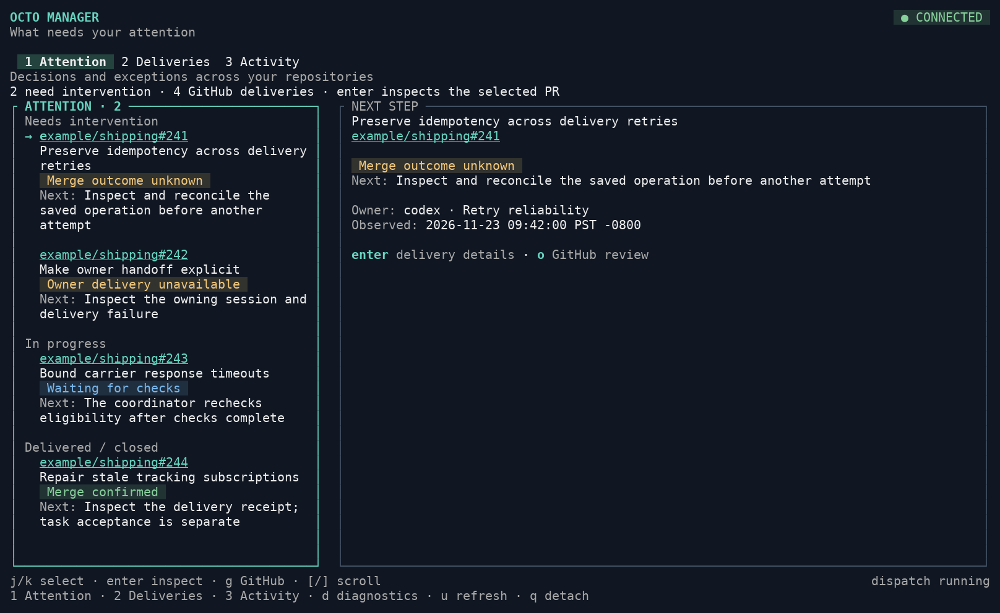
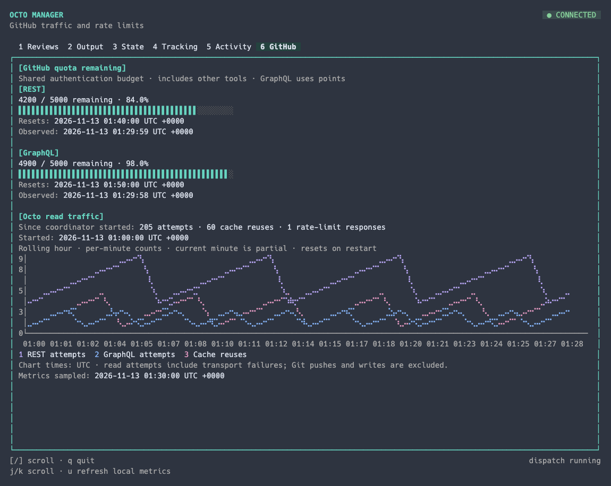

# Octo Manager

Octo Manager coordinates issue remediation and GitHub PR delivery through a local CLI and Charmed dashboard. Versioned issue briefs guide investigation, implementation and testing, followed by separate acceptance verification. The coordinator owns durable decisions and authorized tracker/Git/GitHub effects; scoped agents perform the work. Existing PR tracking, review delivery, repairs, dependencies and guarded auto-merge remain independently usable.



Start with [issue setup](docs/issues.md) and the [state-machine and flow guide](docs/issue-flows.md). The [live acceptance record](docs/live-acceptance.md) distinguishes provider trials from controlled tests and representative renderings.

## Run

Requires Node 22+ for quality tools, Bun 1.4.4, Git, GitHub CLI, and the Go toolchain declared by `go.mod` (currently Go 1.26.11). Builds and checks select that Go toolchain automatically. Linux and macOS are supported.

```sh
bun install --frozen-lockfile --ignore-scripts
bun run build
bin/octo-manager serve
```

In another terminal, attach the native Charmed dashboard:

```sh
bin/octo-manager dashboard
```

From Codex or a third terminal:

```sh
bin/octo-manager job submit summarize-pr --url https://github.com/earendil-works/pi/pull/11546 --request-id first-pr --json
bin/octo-manager job show JOB_ID --json
bin/octo-manager job events JOB_ID --watch
```

All processes use the same state directory. The default is `~/.local/state/octo-manager`; select another with `--state DIR` or `OCTO_MANAGER_STATE`. Existing prototype databases can be selected explicitly with `--state`; API clients must use the new Connect protocol. For a persistent macOS service and automatic Codex enrollment, use the [local installation guide](docs/local-install.md). Manual runs remain available on both platforms. Codex notifications attach to an already running local Codex app-server; installation does not change MCP configuration.

Quitting the dashboard detaches it and leaves jobs running. Stop `serve` explicitly with Ctrl-C for graceful coordinator shutdown. The dashboard reconnects when the service returns. The default `--theme terminal` inherits the terminal's reported background and foreground while keeping Charmed's semantic colors. It does not replace Kitty's background. Use `--theme dark`, `light`, `contrast`, or `mono` for an explicit palette.

Dashboard timestamps use local time, honoring `TZ` when set and otherwise the OS timezone. Use `--timezone` to override presentation for one dashboard. For example, `TZ=Asia/Tokyo bin/octo-manager dashboard` uses Tokyo time; `bin/octo-manager dashboard --timezone America/Los_Angeles` selects Los Angeles explicitly. `--timezone local` restores the `TZ`/OS default, and `--timezone UTC` selects UTC. An invalid explicit zone fails before the UI starts. Stored Unix milliseconds, API values, ordering, and elapsed durations remain unchanged.


## Existing authentication

The Pi worker uses existing Pi ChatGPT authentication when configured, otherwise a read-only in-memory reference to a fresh file-backed Codex ChatGPT session under `CODEX_HOME` (default `~/.codex`). It does not create a Pi credential file or pass through Codex refresh/identity tokens. Codex owns its session refresh. File-backed ChatGPT authentication is supported; keychain-only and API-key Codex sessions are not supported by this fallback.

If no usable session exists, `bin/octo-manager login` opens Pi with tools and discovery disabled. Enter `/login openai-codex`, complete sign-in, and `/quit`. GitHub adapters use the existing `gh` login for accessible public and private repositories. The Pi summary demo separately rejects private or indeterminate repository visibility before content reaches its model. Public demo PR content goes to the selected model provider. Issue dispatch uses the configured Codex app-server and stage profiles. The default model is `gpt-6.1-terra`; pass `--model MODEL` to `serve` to select another OpenAI Codex provider model.

### Amazon Bedrock

Use a provider-qualified model, such as `serve --model amazon-bedrock/us.anthropic.claude-sonnet-5-5`. Unqualified model names retain the OpenAI Codex provider. Bedrock workers use Pi's native AWS credential resolution and an empty read-only credential store; they do not require ChatGPT authentication or copy credentials. Supply an explicit `AWS_PROFILE`, AWS access-key variables, ECS/web-identity configuration, or `AWS_BEARER_TOKEN_BEDROCK`. Missing Bedrock configuration fails without falling back to Codex.

Persist the default worker model in `$XDG_CONFIG_HOME/octo-manager/config.json` (normally `~/.config/octo-manager/config.json`) so a managed reinstall does not replace your selection. `serve --model` overrides this value. PR drafting and repair profiles have separate model settings:

```json
{
  "workerModel": "amazon-bedrock/us.anthropic.claude-sonnet-5-5",
  "submissionModels": {
    "policy": "amazon-bedrock/us.anthropic.claude-sonnet-5-5",
    "change": "amazon-bedrock/us.anthropic.claude-sonnet-5-5",
    "writer": "amazon-bedrock/us.anthropic.claude-sonnet-5-5"
  }
}
```

Merge these keys into your existing configuration. Services must also receive your existing AWS environment. On Linux, a user-owned systemd drop-in survives regeneration of the managed unit. For an existing trusted shell environment file, `systemctl --user edit octo-manager.service` can select the installed launcher without pinning an old release:

```ini
[Service]
ExecStart=
ExecStart=/bin/bash -c '. "$$HOME/.config/bedrock/env" && exec "$$HOME/.local/bin/octo-manager" serve'
```

The environment file remains your credential source; keep it private. Reload the user service manager and restart Octo after changing service settings. On macOS, configure AWS credentials in the launchd service environment before starting Octo.

## PR tracking

Enroll public or private PRs with `bin/octo-manager pr track --url URL --thread-id CODEX_THREAD_ID`. Attention and delivery detail show durable ownership, GitHub blockers, and delivery to the responsible session independently of worker runs. Octo watches checks in the background and returns check completion and actionable failures through the owning agent's durable inbox; callers can continue working after enrollment. See the [tracking guide](docs/tracking.md) for profiles, message receipts, recovery, and private-data boundaries.

## Dashboard and commands

The dashboard opens on Attention. Its primary views organize work by the next decision and the evidence needed to make it:

| Tab | Purpose | Layout |
| --- | --- | --- |
| **1 Attention** | Exceptions and decisions before routine progress | Ranked delivery list with selected preview on wide terminals |
| **2 Deliveries** | Every PR's current condition, next step and observation time | Full-width inventory; Enter opens delivery detail |
| **3 Activity** | Saved effects, coordinator events and caller reports | Selected operation inspection; Enter opens full evidence |
| **d Diagnostics** | Reviews, worker output, runtime, tracking, API budgets and issues | Six dedicated diagnostic views; Esc returns to the originating view |

Delivery detail separates configured auto-merge, current eligibility and the observed outcome. It preserves incomplete or old-head evidence and shows feedback transport, recipient receipt and owner disposition separately. The opt-in `a` switch is available in delivery detail and diagnostic Tracking; an enabled switch does not imply checks or owner assessment have passed. Confirmed merging remains separate from task acceptance. See the [dashboard layout guide](docs/dashboard.md) for responsive behavior and representative renderings.

Reviews load through the shared scheduler on first selection; press `u` to queue a refresh. The dashboard receives cached state on each coordinator tick, retaining content while requests wait or fail. Review observations retain explicit partial-history and truncated-body markers; accessible public and private PRs are supported. GitHub observations and worker completion remain distinct. The [API guide](docs/api.md) describes freshness and limits.

Press `g` or `o` to open the selected PR with the system browser (`open` on macOS, `xdg-open` on Linux), or use its visible URL directly. Local conflict demos have no GitHub delivery; inspect them under Diagnostics → Runtime.

Charmed's `pattern.ListInspector` owns multiline row geometry, stable selection, scrolling and responsive inspection. Octo supplies ordered records, evidence and actions; `tui.Screen` arranges the application chrome and diagnostics. Use `1`–`3` for primary views, `j/k` or up/down to select, Enter to inspect, Esc to return, `[`/`]` to scroll, and `q` to detach. Narrow lists retain every record; inspection uses the full width. Within Diagnostics, `1`–`6` select Reviews, Output, Runtime, Tracking, GitHub and Issues. Output and Runtime retain `h/l` run selection, `p/c/r` worker controls and Tab pane focus. Very small terminals retain a quit hint.

```text
octo-manager job submit summarize-pr --url https://github.com/OWNER/REPO/pull/NUMBER --request-id ID
octo-manager job show JOB_ID --json
octo-manager job events JOB_ID --after SEQUENCE [--watch]
octo-manager job cancel JOB_ID
octo-manager job retry JOB_ID
octo-manager pause
octo-manager resume
```

CLI responses are JSON; `--json` selects compact output. Event pages contain at most 200 records. Retain submission request IDs when reconciling uncertain outcomes. Cancellation acknowledgment can precede worker exit; inspect the job until terminal. The project-local Codex skill under `.agents/skills/octo-manager` explains submission and observation without a global installation.

## API and architecture

The [Pi harness guide](docs/pi-guide.md) explains the SDK, bounded worker, and Codex integration. The [Protobuf contract](proto/octomanager/v2/scheduler.proto) generates Go and TypeScript bindings. ConnectRPC runs over HTTP/1.1 on an owner-only Unix socket. The [API guide](docs/api.md) defines cursor/replay semantics, idempotency, errors, deadlines, and disconnect behavior. The [architecture guide](docs/architecture.md) includes ownership and state diagrams.

`demo` first creates a real merge conflict in `retry-policy.json`, then queues a summary of public Pi PR 11546. The required merge keeps `maxAttempts=3` from the target and `timeoutSeconds=60` from the source, with `retryDelaySeconds=1`. The coordinator rejects either unchanged side, extra keys/paths, invalid values, and conflict markers, then commits and checks a clean two-parent merge. Only generated repositories are changed, and user hooks/signing are disabled for these fixtures.

Jobs have a three-minute attempt deadline, twelve model turns, forty tool calls, and bounded displayed output. Transient errors get at most three attempts with one- and five-second delays. Scheduler retries, cancellation, and crash recovery remain independently tested. These limits apply to Pi jobs. Issue assignment concurrency, timeouts and remote effects follow the separate [issue lifecycle](docs/issue-flows.md).

## Polling and auto-merge

[Adaptive polling and quota forecasts](docs/polling-and-auto-merge.md) reduce idle traffic and show whether the shared hourly budget is at risk. Auto-merge is an Octo-owned per-PR switch in Tracking (press `a`) or `pr auto-merge PR --on|--off --agent-id ID`; exact-head owner readiness still gates dispatch.

## Dependency-aware merge chains

[Merge chains](docs/merge-chains.md) connect confirmed dependencies across repositories. References suggest relationships; explicit queues authorize selected PRs; owner assessments authorize the current reviewed head. Deterministic preparation runs before another owner assessment and a head-pinned merge.

## Agent activity

Press **3 Activity** for saved operations and named activity across sessions. Existing coordinator events appear automatically; calling agents report external work with `record-activity`, including outcome, session, optional harness version/model, PR link, and evidence. Reported success remains distinct from confirmed operation outcomes. Use `r` to reconcile a selected eligible uncertain operation by its saved ID; request acceptance does not confirm its outcome. See the [activity guide](docs/activity.md) for the CLI, typed API, and SQL schema.

Press **d**, then **5 GitHub**, for REST and GraphQL quota bars and a Charmed chart of read attempts per minute. Quota values come from the latest GitHub response headers and include other tools sharing the same authentication; GraphQL remaining values are points. Missing quota evidence and observations past their reset time remain explicit. The chart shows up to 60 minutes of this coordinator's REST attempts, GraphQL attempts, and confirmed cache reuses, with a partial current minute. Counts include transport failures and exclude Git pushes and GitHub writes. History and totals reset when the coordinator restarts. Dashboard refreshes read these metrics locally and make no additional GitHub requests.



## Development

```sh
node scripts/check-typescript.mjs tools
bun run generate
bun run check
```

Generation uses pinned Buf, Protobuf-ES, protoc-gen-go, and protoc-gen-connect-go versions. Checks build both applications, run the dotfiles TypeScript compiler/lint/format profile, exercise the Bun scheduler and Connect API, audit Bun dependencies, and run the committed strict Go profile with race tests and reachable-vulnerability analysis. Biome lint is required without baseline exceptions, alongside typed ESLint and Prettier. TypeScript uses the existing-code retrofit: `.typescript-quality-baseline.json` records current findings and cannot grow; this is not full TypeScript compliance. Go uses strict enforcement without a baseline. Quality tools are isolated under `.typescript-quality/` with their own pinned npm lockfile; application dependencies remain managed by Bun. The same command runs in Linux/macOS CI. Provider-backed live acceptance requires network access and existing credentials; controlled tests do not establish provider availability.

The quality compiler includes source, tests, and generation scripts. It uses Bun-compatible module resolution while preserving the independent NodeNext application build. Only generated Protobuf and Codex protocol files are excluded from lint/format inventory. Imported dependency declarations are still checked; current Bun/Gaxios declaration incompatibilities are visible in the retrofit baseline. After fixing existing findings, run `node scripts/check-typescript.mjs ratchet` and commit the reduced baseline. New findings, missing modules, and suppression-policy violations fail the check.

Rebase PRs with tools-first conflict repair using the [rebase repair guide](docs/rebase-repairs.md).

Agent notifications follow the [agent message standard](docs/agent-messages.md): a content catalog, typed item possibilities, representative rendered messages and receipt/authority rules, with untrusted evidence available only through deliberate inspection. The [generated message examples](docs/generated/agent-message-examples.md) come from the production renderers and are checked for freshness in CI. The [security guide](docs/security.md) includes a practical threat model and worked malicious-review example, and separates bounded assessment from execution authority.

## PR submission

Octo accepts caller-written PR titles and descriptions, validates local format rules, and returns a durable pending receipt before a short-lived publisher contacts GitHub. Use `pr init`, `pr validate --title TITLE --body-file FILE`, then `submit-pr --title TITLE --body-file FILE`; inspect completion with `submission ID`. No daemon or model is required for submission. Optional `pr init --derive` samples bounded repository guidance and recent PRs to propose advisory writing guidance. Publication defaults to tracking for a Codex thread. Use `--no-track` to opt out or `--track` to require a supported owner identity. See [the submission contract and acceptance evidence](docs/pr-submission.md). The public-only restriction above applies to the older PR-summary demo.

`bun run check` gives the typed TypeScript analyzer an explicit 4 GiB Node heap budget on both local machines and CI; Octokit declarations exceed the default roughly 2 GiB heap on hosted macOS. Individual lint runs use `node --max-old-space-size=4096 scripts/check-typescript.mjs lint`. This changes analysis memory limits, without disabling rules or growing the retrofit baseline.

The [CLI guide](docs/cli.md) describes capability groups and agent shortcuts. The [local API](docs/api.md) uses typed v2 contracts shared by the coordinator and dashboard.

## Protobuf quality

The managed source-code profile selects beta-stage Protobuf checks with owned authority and adoption hold. Existing Go/TypeScript checks and the application stack remain in place. Run `python3 scripts/check-protobuf.py tools` once to provision pinned Buf and build its native JSON-string rule, then `bun run generate` to regenerate formatted schemas and Go/TypeScript bindings. Domain-message documentation comes from the canonical contracts and exporter; edit those inputs rather than generated files.

Run `PROTOBUF_AGAINST='.git#ref=origin/main' bun run check` for full verification against the integration branch. The standalone gate is `python3 scripts/check-protobuf.py all --against '.git#ref=origin/main'`. Use the actual PR base or released revision when checking a change; there is no ratchet or ignored-field exception. CI uses the PR base SHA or the previous push SHA, and manual runs require a baseline revision. These checks preserve the v2 contract and do not require restarting the daemon or migrating stored state.

## Issue lifecycle

Explicitly enroll issues for investigation, versioned briefs, clarification, implementation, testing, review, and post-merge acceptance verification. Repository policy controls each authority gate; tracker and dispatcher ports keep GitHub and Codex replaceable. See the [issue lifecycle guide](docs/issues.md) for configuration, commands, evidence, and recovery. **d**, then **6 Issues**, shows current issue work.
