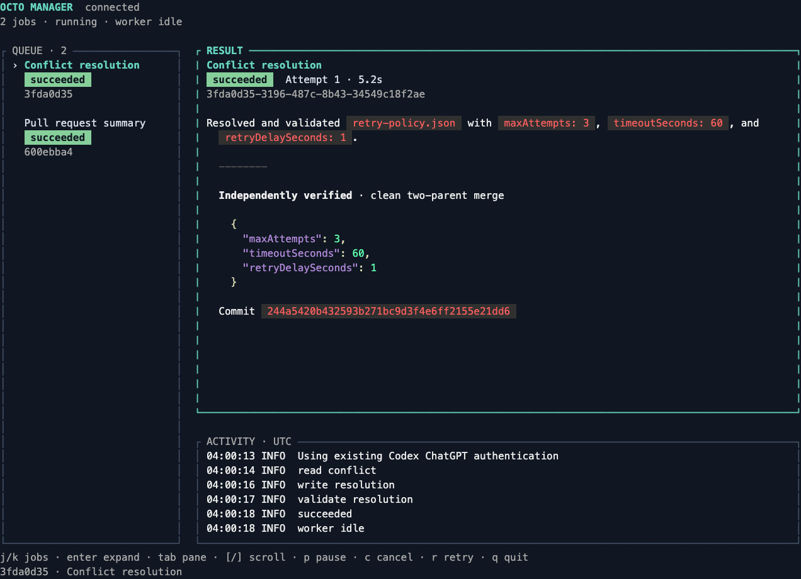

# Octo Manager

A GitHub pull request dashboard backed by bounded Pi workers. Codex submits and observes jobs through a local CLI; Pi reasons with scoped tools; the coordinator owns Git/GitHub effects. The working path covers public PR reviews and discussion, worker summaries, and an actual disposable merge conflict.



See the [live acceptance record](docs/live-acceptance.md) for the actual conflict, PR summary, and detach/reattach evidence.

## Run

Requires Node 22+ for quality tools, Bun 1.4.4, Git, GitHub CLI, and the Go toolchain declared by `go.mod` (currently Go 1.26.11). Builds and checks select that Go toolchain automatically. Linux and macOS are supported.

```sh
bun install --frozen-lockfile --ignore-scripts
bun run build
bin/octo-manager serve
```

In another terminal, attach the native Charmed dashboard:

```sh
bin/octo-manager dashboard
```

From Codex or a third terminal:

```sh
bin/octo-manager submit summarize-pr --url https://github.com/earendil-works/pi/pull/11546 --request-id first-pr --json
bin/octo-manager get JOB_ID --json
bin/octo-manager events JOB_ID --watch
```

All processes use the same state directory. The default is `~/.local/state/octo-manager`; select another with `--state DIR` or `OCTO_MANAGER_STATE`. Existing prototype databases can be selected explicitly with `--state`; API clients must use the new Connect protocol. There is no installed Octo daemon, automatic dotfiles setup, or MCP configuration change. Codex notifications attach to an already running local Codex app-server.

Quitting the dashboard detaches it and leaves jobs running. Stop `serve` explicitly with Ctrl-C for graceful coordinator shutdown. The dashboard reconnects when the service returns. Use `--theme dark`, `light`, `contrast`, or `mono` when launching the dashboard.

## Existing authentication

The worker uses existing Pi ChatGPT authentication when configured, otherwise a read-only in-memory reference to a fresh file-backed Codex ChatGPT session under `CODEX_HOME` (default `~/.codex`). It does not create a Pi credential file or pass through Codex refresh/identity tokens. Codex owns its session refresh. File-backed ChatGPT authentication is supported; keychain-only and API-key Codex sessions are not supported by this fallback.

If no usable session exists, `bin/octo-manager login` opens Pi with tools and discovery disabled. Enter `/login openai-codex`, complete sign-in, and `/quit`. GitHub reads use the existing `gh` login. Private or indeterminate repository visibility is rejected before content reaches the model. Public PR content goes to the selected model provider. The default model is `gpt-6.1-terra`; pass `--model MODEL` to `serve` to select another OpenAI Codex provider model.

## PR tracking

Enroll public or private PRs with `bin/octo-manager track --url URL --thread-id CODEX_THREAD_ID`. The **4 Tracking** view shows durable ownership, GitHub blockers, and Codex triage delivery independently of worker runs. See the [tracking guide](docs/tracking.md) for profiles, acknowledgment, recovery, and private-data boundaries.

## Dashboard and commands

The dashboard centers on pull requests, with one URL header and a compact PR list. **1 Reviews** shows actual GitHub reviews, inline comments, and discussion, including author, message link, observed PR head, and earlier-commit markers. **2 Output** shows the selected worker’s Markdown response. **3 State** shows its observed Charmed state diagram with the latest transition highlighted and timestamped transitions. The worker pane stays visible with run status, attempt, process exit observation, and recent tool calls.

Reviews load on first selection; press `u` to refresh. Reads are public-only and capped at the first 100 records per message source, with explicit partial-history and truncated-body markers. GitHub observations and worker completion remain distinct. The [API guide](docs/api.md) describes freshness and limits.

Press `o` to open the PR with the system browser (`open` on macOS, `xdg-open` on Linux), or use its visible URL directly. The local conflict demo has no GitHub review feed or browser target and opens on its State tab.

The dashboard pins Charmed’s `f502811` revision ([log-level atoms PR](https://github.com/lanej/charmed/pull/29)) and uses its native tabs, header/footer, connection indicator, scrollbar, log-level atoms, state diagram, themes, panels, focus, viewports, structured logs, and Glamour Markdown. Retry cycles retain chronological transition traces. Diagrams can grow vertically inside the scrollable State view; terminals too narrow for a diagram retain the textual path and full history. The main view and recent tools scroll independently. Use `j/k` or up/down to select a PR or demo, `h/l` or left/right to inspect its runs, Enter to expand, `1/2/3` to change view, Tab to change scroll pane, `[` and `]` to scroll, `p` to pause dispatch, `c` to cancel the selected run, `r` to retry it, and `q` to detach. Narrow terminals stack panes, and very small terminals retain a quit hint.

```text
octo-manager submit summarize-pr --url https://github.com/OWNER/REPO/pull/NUMBER --request-id ID
octo-manager get JOB_ID --json
octo-manager events JOB_ID --after SEQUENCE [--watch]
octo-manager cancel JOB_ID
octo-manager retry JOB_ID
octo-manager pause
octo-manager resume
```

CLI responses are JSON; `--json` selects compact output. Event pages contain at most 200 records. Retain submission request IDs when reconciling uncertain outcomes. Cancellation acknowledgment can precede worker exit; inspect the job until terminal. The project-local Codex skill under `.agents/skills/octo-manager` explains submission and observation without a global installation.

## API and architecture

The [Pi harness guide](docs/pi-guide.md) explains the SDK, bounded worker, and Codex integration. The [Protobuf contract](proto/octomanager/v1/scheduler.proto) generates Go and TypeScript bindings. ConnectRPC runs over HTTP/1.1 on an owner-only Unix socket. The [API guide](docs/api.md) defines cursor/replay semantics, idempotency, errors, deadlines, and disconnect behavior. The [architecture guide](docs/architecture.md) includes ownership and state diagrams.

`demo` first creates a real merge conflict in `retry-policy.json`, then queues a summary of public Pi PR 11546. The required merge keeps `maxAttempts=3` from the target and `timeoutSeconds=60` from the source, with `retryDelaySeconds=1`. The coordinator rejects either unchanged side, extra keys/paths, invalid values, and conflict markers, then commits and checks a clean two-parent merge. Only generated repositories are changed, and user hooks/signing are disabled for these fixtures.

Jobs have a three-minute attempt deadline, twelve model turns, forty tool calls, and bounded displayed output. Transient errors get at most three attempts with one- and five-second delays. Scheduler retries, cancellation, and crash recovery remain independently tested. This thread has no concurrent worker pool, recurring schedules, or remote GitHub mutation operations.

## Agent activity

Press **5 Activity** for named operations across all sessions. Existing coordinator events appear automatically; calling agents report external work with `record-activity`, including outcome, session, optional harness version/model, PR link, and evidence. Reports are durable and safe to retry; reported success remains distinct from independent verification. See the [activity guide](docs/activity.md) for the CLI, typed API, and SQL schema.

## Development

```sh
node scripts/check-typescript.mjs tools
bun run generate
bun run check
```

Generation uses pinned Buf, Protobuf-ES, protoc-gen-go, and protoc-gen-connect-go versions. Checks build both applications, run the dotfiles TypeScript compiler/lint/format profile, exercise the Bun scheduler and Connect API, audit Bun dependencies, and run the committed strict Go profile with race tests and reachable-vulnerability analysis. TypeScript uses the existing-code retrofit: `.typescript-quality-baseline.json` records current findings and cannot grow; this is not full TypeScript compliance. Go uses strict enforcement without a baseline. Quality tools are isolated under `.typescript-quality/` with their own pinned npm lockfile; application dependencies remain managed by Bun. The same command runs in Linux/macOS CI. Provider-backed live acceptance requires network access and existing credentials; controlled tests do not establish provider availability.

The quality compiler includes source, tests, and generation scripts. It uses Bun-compatible module resolution while preserving the independent NodeNext application build. Only generated Protobuf and Codex protocol files are excluded from lint/format inventory. Imported dependency declarations are still checked; current Bun/Gaxios declaration incompatibilities are visible in the retrofit baseline. After fixing existing findings, run `node scripts/check-typescript.mjs ratchet` and commit the reduced baseline. New findings, missing modules, and suppression-policy violations fail the check.
