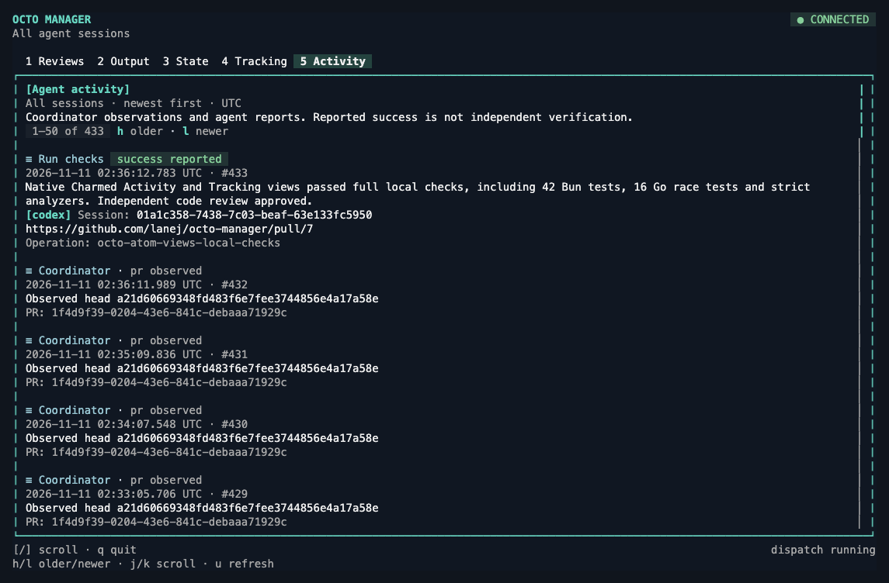
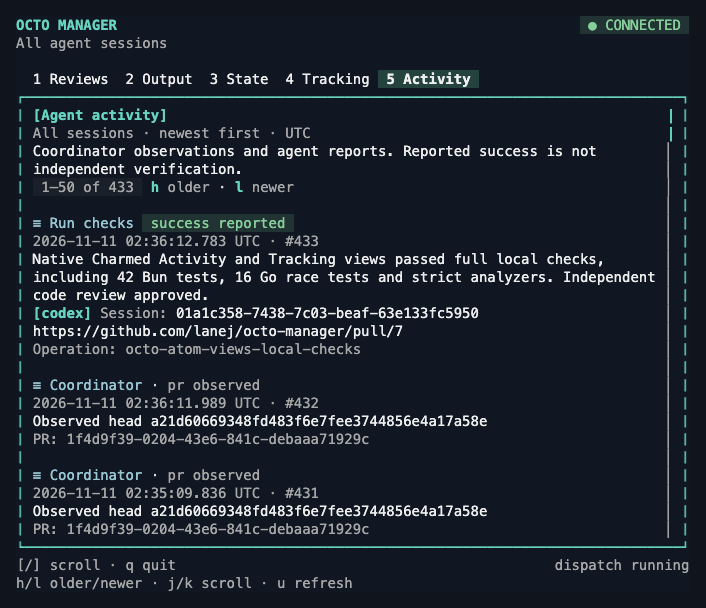
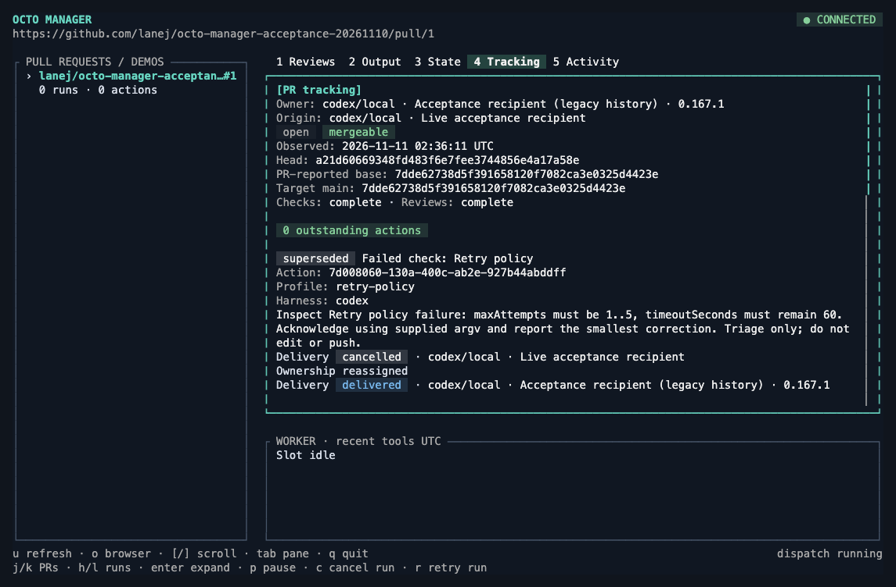

# Agent activity

Octo records named agent operations alongside its existing worker, blocker, and delivery events. Press **5 Activity** in the dashboard for a global timeline across sessions, including activity with no worker job or tracked PR. The view shows the operation, reported outcome, session/harness, optional runtime version and model, PR link, evidence, and recorded time. The UI renders a cached window of 50 entries. Use **h/l** for older/newer pages, **j/k** or **[/]** to scroll within a page, and **u** to refresh. Loaded history remains available for page navigation; new reports can shift a page as the live timeline grows.

Coordinator events are recorded automatically by existing operations. Work performed outside Octo, such as a calling agent merging a PR or running checks, must be reported explicitly through the CLI or typed RPC. This does not instrument every agent session automatically. Actor metadata and outcomes are supplied by the caller; recording a success does not independently verify execution, authenticate an agent identity, acknowledge a blocker, or resolve it.

## Named operations and outcomes

| Name | Meaning |
| --- | --- |
| `merge_pr` | Attempt or result of merging a PR |
| `run_checks` | Running a chosen set of checks; describe which in the detail |
| `resolve_conflict` | Conflict work; shares the existing executable task name |
| `summarize_pr` | PR summary work; shares the existing executable task name |
| `notify_agent` | Attempt or result of notifying another agent; delivery is distinct from acknowledgment |

Outcomes are enum values: `attempted`, `succeeded`, `failed`, and `uncertain`. These are immutable reports, not a mutable execution state machine. For example, preserve an attempted send and its uncertain result as separate reports; a later observation can add evidence without rewriting either report. Reuse an operation ID for one attempt and give every distinct report its own request ID. A new execution attempt should use a new operation ID.

## Report from any harness

Keep the coordinator running with `octo-manager serve`. Use the same `--state` directory for the reporter and dashboard, or set `OCTO_MANAGER_STATE` for the Bun CLI. No worker or PR enrollment is required.

```sh
octo-manager record-activity \
  --name merge_pr --outcome attempted \
  --request-id pr42-merge-attempt --operation-id pr42-merge \
  --harness codex --thread-id SESSION_ID \
  --url https://github.com/owner/repo/pull/42 \
  --detail 'Starting merge of reviewed head abc123'

# Perform the operation through the calling agent's authorized tools.

octo-manager record-activity \
  --name merge_pr --outcome succeeded \
  --request-id pr42-merge-result --operation-id pr42-merge \
  --harness codex --thread-id SESSION_ID \
  --url https://github.com/owner/repo/pull/42 \
  --detail 'GitHub reports MERGED; fetched main contains the merge commit' \
  --evidence https://github.com/owner/repo/commit/MERGE_SHA

octo-manager activity --after 0 --json
```

Use `failed` when failure is known and `uncertain` when the operation may have happened but confirmation is unavailable. Optional `--harness-version` and `--model` snapshot caller-supplied metadata without changing that session. Other harness names are accepted. Supply only metadata suitable for the local activity database; do not include credentials in detail or evidence URLs.

Replaying a request ID with an identical normalized report returns the original record and sequence. Reusing it with different content fails with `AlreadyExists`. A timeout during reporting can therefore be retried with the same ID. A retry of reporting must not re-execute the underlying operation. Reports cannot reconstruct missing earlier attempts; recording a historical result timestamps when the report was stored, not when the external action happened.

## Data and API

`RecordActivity` receives an `ActivityInput`; `ActivityName` and `ActivityOutcome` are Protobuf enums. The coordinator validates the report before storage. Names reuse existing task terminology; adding another operation requires updating the typed catalog, wire enum, UI label, and database constraint through a migration. Harnesses remain metadata, so adding another harness does not require an operation or schema change.

```typescript
interface ActivityInput {
  requestId: string;       // Idempotency key for this immutable report.
  operationId: string;     // Caller-owned correlation ID for one attempt.
  name: ActivityName;
  outcome: ActivityOutcome;
  actor: { harness: string; sessionId: string; version?: string; model?: string };
  detail: string;
  prUrl?: string;
  evidenceUrl?: string;
}
```

The additive SQLite version 2 migration preserves jobs, tracking state, events, and instance identity. Each report is inserted atomically with an `agent_activity` event. Its sequence is the existing global event sequence, and timestamps remain integer milliseconds. The database enforces operation/outcome values, payload-column consistency, unique request IDs, and the event reference.

```sql
CREATE TABLE agent_activity (
  sequence INTEGER PRIMARY KEY REFERENCES events(seq),
  request_id TEXT NOT NULL UNIQUE,
  operation_id TEXT NOT NULL,
  name TEXT NOT NULL CHECK(name IN ('merge_pr','run_checks','resolve_conflict','summarize_pr','notify_agent')),
  outcome TEXT NOT NULL CHECK(outcome IN ('attempted','succeeded','failed','uncertain')),
  payload TEXT NOT NULL CHECK(json_valid(payload)),
  recorded_at_ms INTEGER NOT NULL,
  CHECK(json_extract(payload,'$.requestId') IS request_id),
  CHECK(json_extract(payload,'$.operationId') IS operation_id),
  CHECK(json_extract(payload,'$.name') IS name),
  CHECK(json_extract(payload,'$.outcome') IS outcome)
) STRICT;
CREATE INDEX activity_by_operation ON agent_activity(operation_id,sequence);
```

`ListActivity(after_sequence)` scans at most 200 global event rows. It returns typed `activities`, coordinator `events`, `next_sequence`, and `has_more`. Agent reports and coordinator events share sequence order. Streamed model-progress text is omitted from this timeline; its rows still advance the cursor, so even an empty visible page may have more history. Continue using `next_sequence` while `has_more` is true. Existing `ListEvents` and `Watch` retain their contracts. The UI reloads on coordinator events and fences responses by database instance so reconnects cannot mix histories.

Identifiers and actor metadata are nonempty single-line strings of at most 200 characters; detail is a single line of at most 4,000 characters. URLs are limited to 2,000 characters. PR URLs must identify a GitHub pull request and are canonicalized; evidence URLs must use HTTPS without embedded credentials. Terminal control characters are rejected before storage.

## Historical action context

Database version 3 adds nullable `events.action_context_json` and `pr_observations.target_base_json` columns. Existing events, reports, sequences, identities, and timestamps are preserved. Missing historical evidence remains null.

New action events atomically snapshot their state and PR URL. Agent progress events also snapshot the acting agent ID, harness, session, and optional label. Coordinator changes do not borrow an earlier acknowledging agent’s identity. `JobEvent.action_context` carries this context through snapshots, event replay/watch, and activity pages. Activity renders the recorded state and actor without joining today’s mutable action or owner. Legacy progress events explicitly state that their transition state and actor were not recorded; those facts cannot be reconstructed.

```sql
ALTER TABLE pr_observations ADD COLUMN target_base_json TEXT
  CHECK(target_base_json IS NULL OR json_valid(target_base_json));
ALTER TABLE events ADD COLUMN action_context_json TEXT
  CHECK(action_context_json IS NULL OR json_valid(action_context_json));
```

## Native presentation

Activity and Tracking render structured fields directly with Charmed labels, badges, semantic pills, log glyphs, time atoms, pending indicators, and key hints. Outcomes remain explicit: a delivered notification uses an informational tone, agent success stays labeled “success reported,” and only observed resolution uses the resolved state. Tracking places unfinished actions ahead of closed history. The native views retain ANSI-aware wrapping, the 50-entry activity window, cached rendering, paging, and keyboard scrolling; worker output and review prose retain Markdown rendering.






