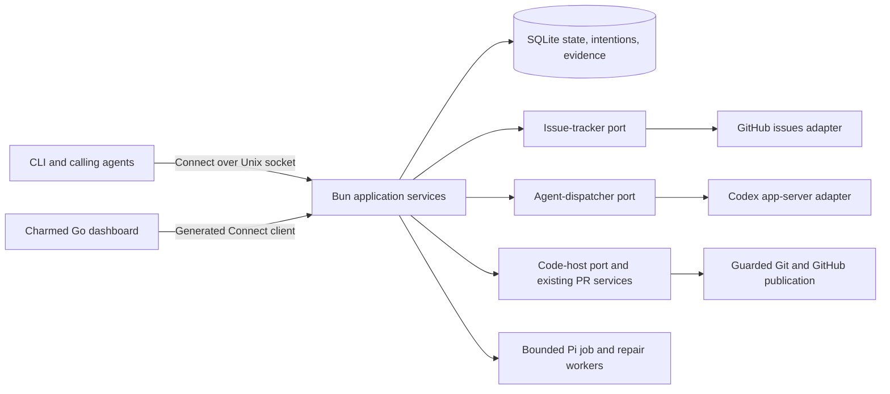
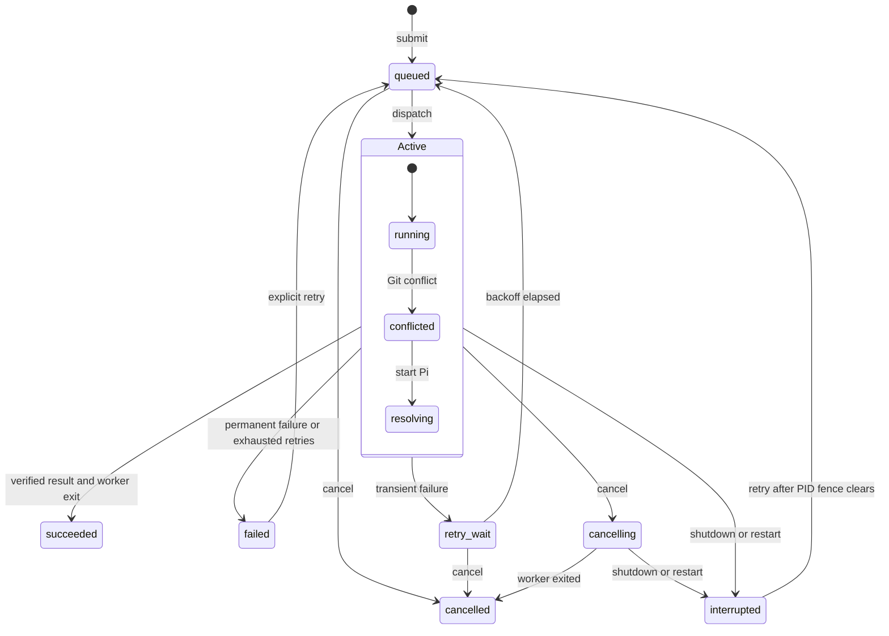

# Architecture

Octo Manager coordinates issue remediation and PR delivery. The Bun coordinator owns durable lifecycle state, scheduling, policy decisions, and daemon-backed effects. A Charmed Go dashboard and CLI use the generated [Connect API](api.md). The standalone PR publisher has a separate receipt journal and does not acquire the coordinator's database lock.

## Capability boundaries

Pragmatic hexagonal architecture keeps lifecycle decisions in a functional core with explicit state and observations. Application services coordinate persistence and effects. Issue-tracker, dispatcher, workspace, and code-host ports isolate demonstrated replacement boundaries; they do not form a universal plugin framework. The first issue tracker is GitHub and the first issue dispatcher is Codex. A different issue tracker can still deliver fixes through GitHub PRs. Provider payloads and protocol details stay in adapters. See [issue flows](issue-flows.md) for the review-level state machines and authority boundaries.

| Capability | Owns | Important separation |
| --- | --- | --- |
| Issues | Brief versions, questions, approvals, lifecycle and acceptance | Done is distinct from tracker closure. |
| Dispatch | Scoped stage assignments, session/turn identity, recovery and cancellation | Accepted interruption is distinct from terminal execution. |
| PR tracking | Provider observations, ownership, blockers, receipts and notifications | Receipt is distinct from action acceptance and observed resolution. |
| Merging/repairs | Explicit dependencies, exact-head readiness, guarded Git work and confirmation | A configured auto-merge switch is distinct from eligibility or a confirmed merge. |
| Publication | Caller-written description, local format contract, frozen request and receipt | Accepted publication is distinct from GitHub creation and tracking enrollment. |
| Pi jobs | Existing bounded summary/conflict tools and worker process lifecycle | Job/PID recovery is distinct from Codex issue-session recovery. |

The coordinator can post issue questions/plans, create approved follow-ups, publish PRs, repair branches, merge authorized PRs, and close verified issues. Those capabilities have separate authorization and evidence gates; observing an issue or receiving a notification grants none of them implicitly. GitHub tracking accepts public and private repositories using existing access; the older Pi summary demo retains its public-only restriction.

## Code organization

Octo groups code by capability. Start in the folder named for the behavior you are changing and follow the entry point through its application operation, decision, data access, and effects. Split responsibilities into files when the split gives a rule or operation a clear owner.

| Location | Responsibility |
| --- | --- |
| `src/<capability>/` | Capability-owned contracts, decisions, orchestration, persistence, and local CLI, RPC, or provider adapters. |
| `src/cli/` and `src/api/` | Shared command parsing and output, Connect route registration, and wire projections. |
| [Coordinator](../src/coordinator.ts) and `src/coordinator/` | Compose the daemon and own its socket, process lifecycle, state lock, shared database, and migration ordering. |
| `src/github/` and `src/jobs/` | Shared GitHub identity, transport, errors, and quota accounting. Pi job state, retry policy, worker support, and demo fixtures belong to jobs. The shared [GitHub review reader](../src/github/reviews.ts) supplies dashboard evidence. The Pi model summary stays with jobs. |
| `proto/`, `src/gen/`, and `gen/` | Versioned API definitions and generated bindings. Public CLI and worker entry points stay at the source root for the packaged runtime. |
| `cmd/octo-manager-tui/`, `internal/client/`, and `internal/tui/` | Terminal entry point, Connect client, and dashboard composition respectively. |

- **Decisions take explicit facts.** `policy.ts` and `decisions.ts` own the decision and its result. [Inherited automation](../src/repository/policy.ts) chooses what to do with the tracked state and can request additional facts. The [repository service](../src/repository/service.ts) gathers those facts, reads [checkout configuration](../src/repository/config.ts) and [saved policy](../src/repository/store.ts), and acts on the decision.
- **Application operations own workflow sequencing.** Capability RPC and CLI adapters validate and map boundary data, then invoke the operation. The [receipt merge request](../src/merging/receipt-request.ts) owns recipient resolution, digest acknowledgment, and scheduling. Acknowledgment and scheduling retain separate outcomes.
- **Storage owns SQL and atomic writes.** Concrete stores are appropriate where SQLite is the implementation and a transaction protects a shared invariant. [Tracking ingestion](../src/tracking/store.ts) applies rules from [tracking policy](../src/tracking/policy.ts) and commits observations, actions, deliveries, and retirement together. Keep unrelated consumers behind narrow reads or operations. Snapshot projections can compose synchronous reads under the daemon's single-owner execution model.
- **Ports belong to the consuming application.** Add one when it isolates a consequential effect or a real substitution boundary. The [issue ports](../src/issues/ports.ts) express tracker and dispatcher effects in issue terms, with implementations in [issue trackers](../src/issue-trackers/github.ts) and [dispatch](../src/dispatch/codex.ts). Use direct concrete calls when their contracts already fit. Preserve provider evidence and unknown outcomes across translation.

### Dashboard and UI components

Keep Bubble Tea lifecycle, stream subscription, focus, cached frames, and responsive composition in `internal/tui`. Arrange dashboard views by capability, as in the [Issues view](../internal/tui/issues_view.go) and [PR tracking view](../internal/tui/tracking_view.go). Put shared Octo-specific mappings with explicit inputs in [dashboard presentation](../internal/tui/presentation/status.go). Rendering consumes coordinator observations and does not decide workflow authority.

Use Charmed's packages for reusable presentation and interaction such as themes, text, layout, focus, charts, and list-and-inspector patterns. A component belongs in Charmed when it can accept application-supplied data and callbacks without Octo concepts, generated API types, or Connect calls. Octo owns workflow views and interpretations, such as mapping an acknowledged action or uncertain delivery to a visual tone.

## Issue orchestration

The issue application owns stages and orthogonal waiting conditions. Explicit enrollment starts investigation. A versioned brief plus repository/operator authority allows implementation. Testing and authorized publication connect to existing PR tracking. A confirmed merge starts separate acceptance verification; a fresh issue observation guards the subsequent close effect.

New input advances the issue epoch before assessment. New briefs clear implementation/publication approvals; no-change assessments retain them. Async results are checked against current epoch, brief, assignment, approvals and policy before application. Already-submitted effects may still complete after a pause/cancel, but their confirmation cannot revive superseded work. Unknown agent acceptance is reconciled through saved session/turn identity, not by starting a replacement. [Assignment recovery and effect flows](issue-flows.md#agent-assignment-and-recovery) detail these transitions and current limits.

The coordinator owns local commits and remote publication. Codex implementation receives workspace-write access without network access; investigation and verification are read-only. Guarded Git effects resolve trusted linked metadata, disable hooks/fsmonitor/signing/filter execution, and reject changed paths needing custom content filters. This is a constrained integration boundary, not a general OS container or a proof that model-generated code is correct.

## Scheduling and presentation

The shared scheduler dispatches provider reads with request spacing, adaptive polling, separate REST/GraphQL budgets, and cooldowns. Services retain observations and explicit completeness; failed or partial reads do not establish a clean state. [Polling](polling-and-auto-merge.md), [tracking](tracking.md), and [merge chains](merge-chains.md) describe their respective freshness and eligibility contracts.

Charmed supplies semantic themes, compiled responsive layouts, focus, viewports, logs, prepared Markdown and retained rendering. The Go frontend owns terminal lifecycle, navigation and cached presentation, not provider polling or domain transitions. Views receive stored frames on the coordinator tick; refresh requests schedule work while cached content remains visible. Disconnecting a dashboard does not cancel jobs or issue assignments. See [dashboard layout](dashboard.md) and the dated [performance evidence](dashboard-performance.md).

## Pi job state machine

The existing Pi job executor retains durable FIFO order, idempotent submissions, bounded retries, and worker PID/exit fencing. These are execution jobs, not the issue lifecycle or Codex assignment journal.

Worker job completion and slot cleanup are separate observations. Cancellation holds the Pi slot until worker exit; restart interrupts jobs and fences replacement against unresolved PIDs. Pi workers use scoped tools with project discovery and built-in shell tools disabled. That restriction applies to these workers; Codex issue sessions use their own scoped sandbox and dispatcher lifecycle. [Issue assignment recovery](issue-flows.md#agent-assignment-and-recovery) preserves the corresponding session/turn distinction.
