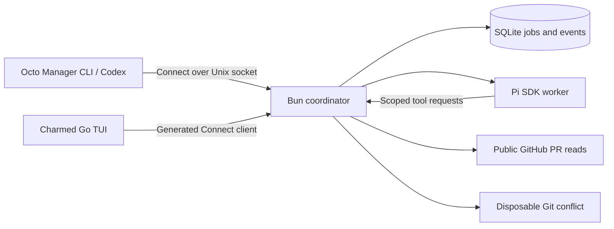
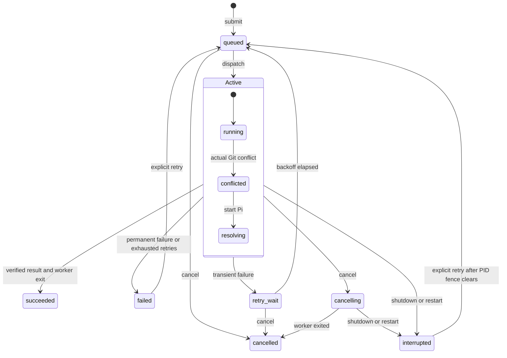

# Architecture

Octo Manager manages bounded GitHub work. Pi supplies model reasoning, the Bun coordinator owns jobs and effects, and a Charmed Go application presents confirmed state. The versioned [Connect API](api.md) is the application boundary.

Charmed provides semantic themes, panel geometry, focus, viewports, structured logs, and Glamour Markdown. The application retains native Bubble Tea commands and component models. It owns API calls, cancellation, selection, reconnect behavior, and result presentation. The UI library does not own scheduler policy or GitHub access. Charmed is pinned as a published Go module; there are no local path replacements or copied widget implementations.

The coordinator retains one active worker, durable FIFO order, idempotent submissions, bounded retries, and worker PID/exit fencing. Cancellation wins over late success and holds the slot until the worker exits. Authentication failures do not retry automatically. Restart interrupts unfinished jobs and fences replacement dispatch until every unresolved previous worker PID has disappeared.

`Active` groups running, conflicted, and resolving states with the shared outgoing transitions. Job completion and worker-slot cleanup are distinct observations. Pause and recovery are scheduler/worker states, separate from the job state machine.

Workers use in-memory Pi sessions with project discovery and built-in shell tools disabled. They can read the requested public PR or read/write/validate the generated policy fixture. The coordinator independently validates the combined policy and confirms a clean two-parent merge before success. This implementation performs no remote GitHub mutations. Pi and its dependencies remain trusted host code; this tool boundary is not an OS sandbox.
