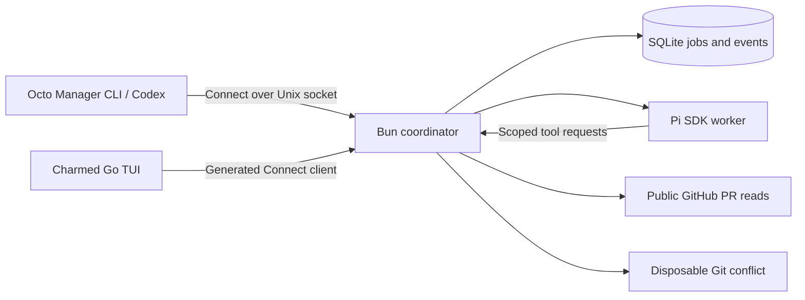
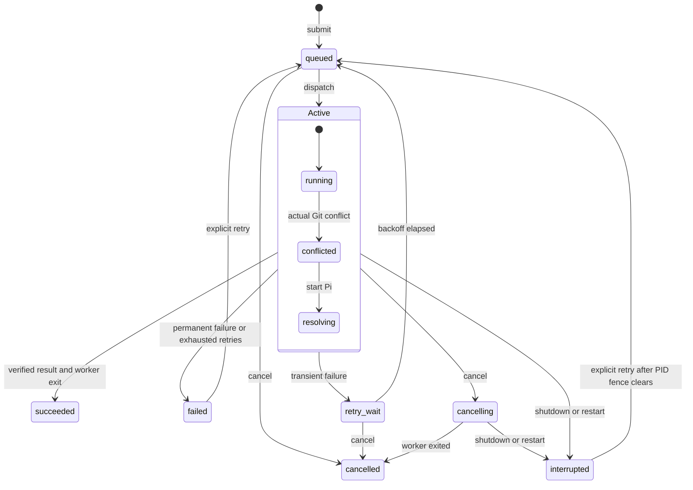

# Architecture

Octo Manager manages bounded GitHub work. Pi supplies model reasoning, the Bun coordinator owns jobs and effects, and a Charmed Go application presents confirmed state. The versioned [Connect API](api.md) is the application boundary.

Charmed provides semantic themes, panel geometry, focus, viewports, structured logs, and Glamour Markdown. The application retains native Bubble Tea commands and component models. It owns API calls, cancellation, selection, reconnect behavior, and result presentation. The UI library does not own scheduler policy or GitHub access. Charmed is pinned as a published Go module; there are no local path replacements or copied widget implementations.

The dashboard’s primary identity is the canonical GitHub PR URL. Multiple submitted jobs for that URL appear as runs beneath one PR; each run retains its own attempts, result, cancellation, and retry history. The API’s job handles remain execution records. PRs appear before standalone demo fixtures, which never acquire a fabricated GitHub URL. Opening a PR is a client-side browser action with a validated HTTPS GitHub PR target; opener errors are displayed.

PR identity derives from the typed task URL. The coordinator’s read-only `GetPullRequest` operation confirms public visibility, then retrieves PR facts, reviews, inline comments, and discussion with observation time and head SHA. Review messages remain separate from Pi output and carry links and commit context; the UI does not infer unresolved findings or current review decisions from historical messages. CI and mergeability tracking remain outside this thread. Real PR conflict repair would be another authorized operation; the disposable conflict is an isolated acceptance fixture.

The default workspace prioritizes review messages with a persistent worker status pane. Worker output and run state/history have separate tabs. The selected run’s complete event history is paginated independently of recent snapshot events. Late responses are fenced by selected job, instance, and request generation. The state map is supplied by the coordinator’s authoritative domain transition graph, while the observed path comes from persisted transitions; it is never inferred from model text.

The coordinator retains one active worker, durable FIFO order, idempotent submissions, bounded retries, and worker PID/exit fencing. Cancellation wins over late success and holds the slot until the worker exits. Authentication failures do not retry automatically. Restart interrupts unfinished jobs and fences replacement dispatch until every unresolved previous worker PID has disappeared.

`Active` groups running, conflicted, and resolving states with the shared outgoing transitions. Job completion and worker-slot cleanup are distinct observations. Pause and recovery are scheduler/worker states, separate from the job state machine.

Workers use in-memory Pi sessions with project discovery and built-in shell tools disabled. They can read the requested public PR or read/write/validate the generated policy fixture. The coordinator independently validates the combined policy and confirms a clean two-parent merge before success. This implementation performs no remote GitHub mutations. Pi and its dependencies remain trusted host code; this tool boundary is not an OS sandbox.

## Tracking ownership

Tracked PRs and pending actions belong to the TypeScript coordinator independently of execution jobs. Pure blocker policy consumes explicit GitHub observations; storage owns transactional uniqueness and observation references. Harness-neutral agent references and action profile snapshots keep execution preferences out of tracking policy. The Codex adapter attaches to an existing daemon over a Unix WebSocket and requests triage without overriding the owning session. Delivery acceptance, agent acknowledgment, and verified GitHub resolution remain separate. See [tracking](tracking.md) for the data and recovery contracts.
