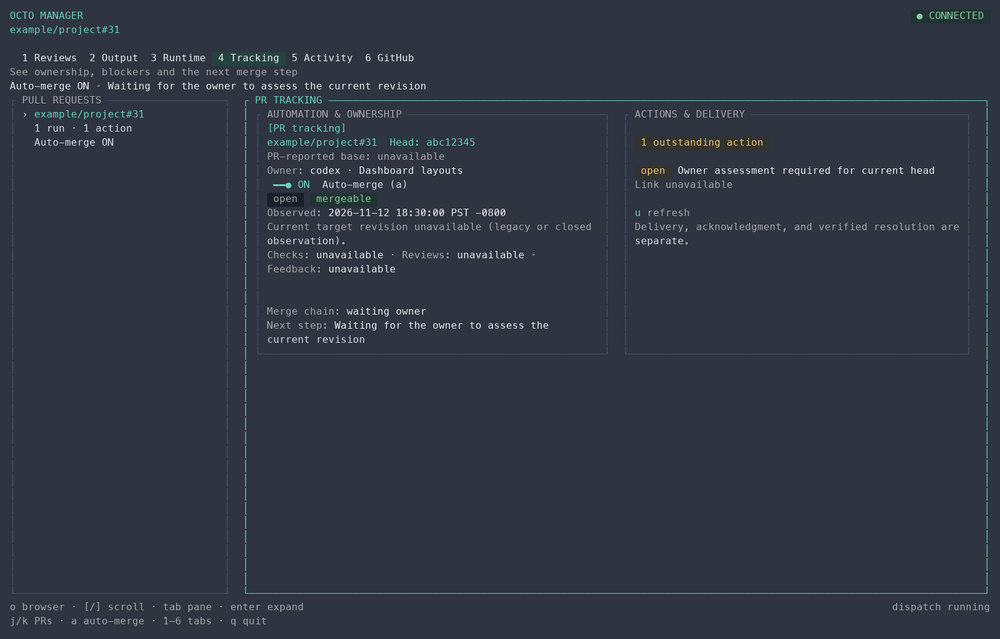
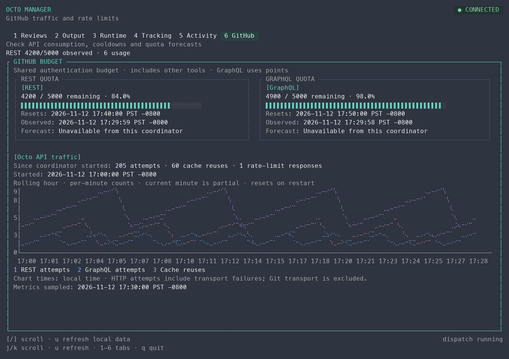

# Dashboard layout

Each tab declares its purpose, main content and supporting regions through Charmed’s `tui.Screen`. The Bun coordinator owns durable data and automation; the Go TUI presents its snapshot and issues explicit commands. Detaching the dashboard leaves the coordinator running.

Reviews and Tracking share PR navigation and pinned merge context. Output and Runtime share PR navigation and a worker pane. Activity and GitHub are global workspaces. Tracking starts by default; the local conflict demo uses Runtime. Worker-run controls are available only on Output and Runtime.

Wide terminals show a PR rail beside the current workspace. Focused or expanded views give the main content the full width while retaining keyboard PR navigation. Short terminals omit the supporting worker pane explicitly. Below the minimum workspace size, the recovery view preserves `q quit`. Main content remains scrollable; it is not discarded to fit the viewport.

Tracking groups automation, ownership and observed state separately from blockers, agent actions and delivery history. These nested sections form columns only when both have enough readable width, otherwise they stack. The PR rail and pinned context show auto-merge configuration independently of readiness: enabled, paused, stopped with reconciliation still pending, or manual. Confirmed closed or merged PRs show that outcome. An enabled switch on a merged entry records its configuration; it does not establish who performed the merge.

GitHub groups REST and GraphQL budgets separately, with forecast uncertainty and observation times preserved. Traffic and cache reuse follow the budget sections. The budgets form columns on wide workspaces and stack on narrower ones.

`MergeStatus.chain_state` is an additive snapshot field, separate from entry progress in `state`. A paused chain can still contain an entry waiting for checks. No stored-state migration is needed. Coordinators that omit the field still supply configuration and entry progress; the UI cannot infer chain pause from those values.

## Representative renderings

These images use the actual dashboard renderer with synthetic repository and agent data. They demonstrate layout and labeling, not a live GitHub observation. Live acceptance also exercised tab navigation, scrolling, resizing from 132 to 80 columns and clean detachment against the local coordinator. Native window capture was unavailable because the Mac was locked.

