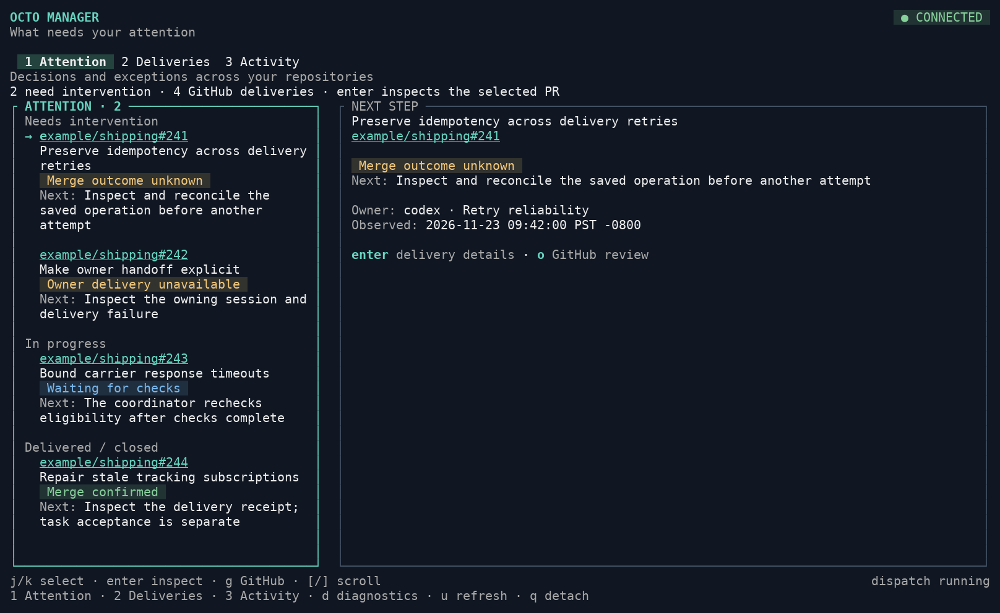
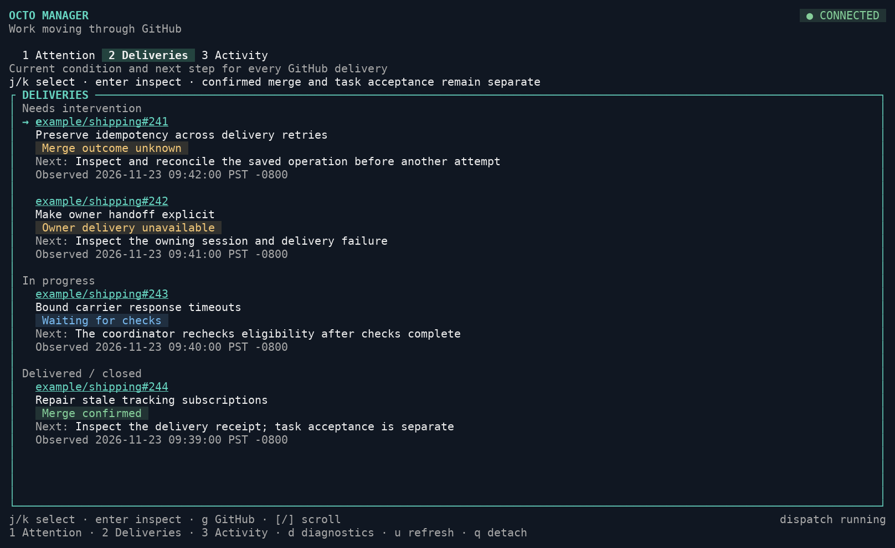
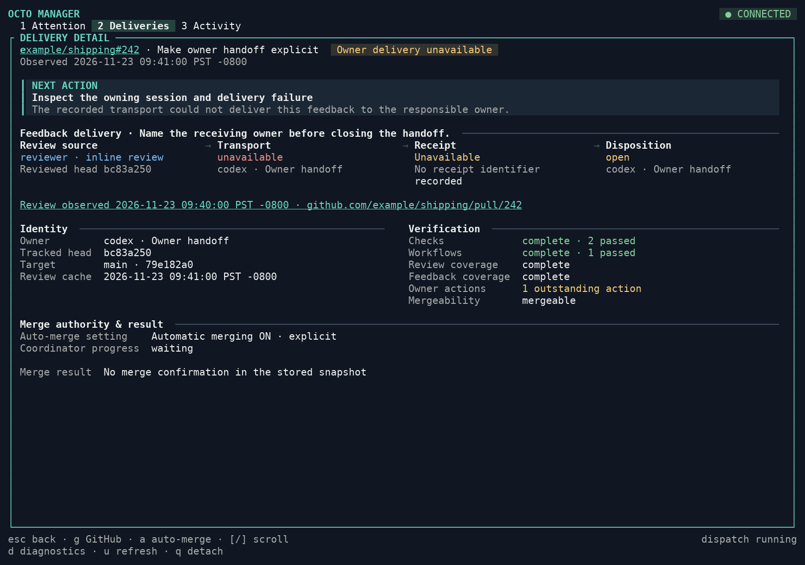
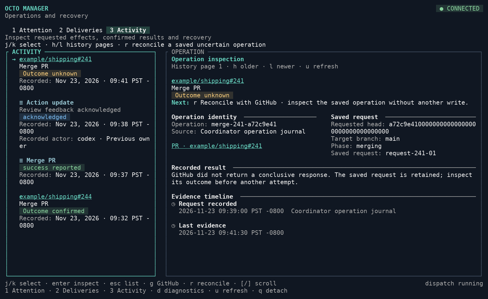
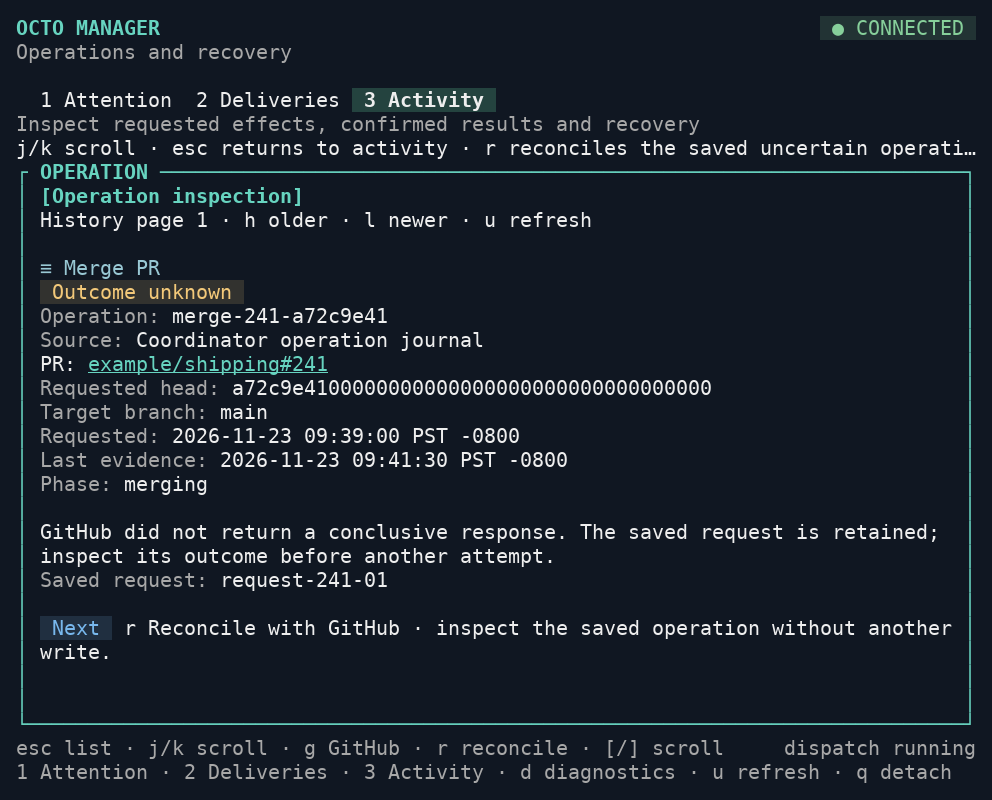

# Dashboard

Attention is the starting view. It puts uncertain outcomes and decisions ahead of ordinary progress, while Deliveries shows the full inventory and Activity explains what happened. The Bun coordinator owns durable state and effects. Octo projects that evidence into typed record summaries and detail documents. Charmed's `pattern.ListInspector` owns selection, row geometry, scrolling and responsive inspection; `layout.RecordSummary` and `layout.DetailDocument` own the hierarchy of titles, conditions, next steps, field groups, status lists and event timelines.

| View | Read it for | Controls |
| --- | --- | --- |
| **1 Attention** | Ranked exceptions, current condition and next step | j/k select; Enter delivery detail |
| **2 Deliveries** | All PRs, including progress and confirmed closed/merged outcomes | j/k select; Enter delivery detail |
| **3 Activity** | Saved operations, coordinator events and caller reports | j/k select; Enter operation inspection; Esc list |
| **d Diagnostics** | Reviews, Output, Runtime, Tracking, GitHub and Issues | 1–6 select; Esc returns to the originating view |

Wide Attention and Activity views show the selected record beside the list. Narrow views retain the list and open inspection at full width. Selection follows stable PR or saved-operation identity through reorder and refresh; removing a record leaves its inspection instead of silently relabeling another record. `[` and `]` scroll the active list or inspected evidence. Short workspaces omit secondary panes explicitly; below the minimum allocation, `q quit` remains visible.

## Delivery evidence

Delivery detail keeps the current condition and next step above separate identity, readiness, merge and feedback sections. Related facts align within each section; adjacent sections share a row when they fit and stack at narrower widths. Identity and observation remain separate from readiness assessments, and each feedback recipient has its own delivery section. Checks and workflow evidence identify different-head and unpinned results. Review-cache observations state when they differ from the tracked revision or contain partial history. A failed refresh retains its last observation and the error.

Configured auto-merge, coordinator progress and confirmed outcomes are separate. `a` toggles the existing setting in detail or diagnostic Tracking; it does not assert readiness. An automatic-merge setting of off does not establish whether a separate one-shot authorization exists. Confirmed merging does not establish task acceptance.

Feedback identifies its source and reviewed revision, transport state, recipient receipt and owner disposition. A delivered notification does not imply receipt or resolution. Missing receipt identifiers remain unavailable. Closed and merged PRs retain historical action evidence without promoting old actions into new interventions.

## Operation inspection

Activity combines up to 50 saved operations with one bounded page of historical events and caller reports. Saved-operation detail separates operation identity, the saved request, recorded result and evidence timeline. It identifies the requested head, target, phase and request ID, while the timeline retains the supplied request and last-evidence timestamps. Caller reports retain labels such as “success reported”; historical events retain their recorded actor and transition rather than borrowing current ownership.

`r` reconciles a selected eligible uncertain operation using its exact saved ID. Request acceptance is not a confirmed outcome. Failed reads retain earlier evidence and require explicit refresh before reconciliation. Coordinator replacement clears old evidence and pending request state, including when another view is active. Use `h/l` for older/newer historical pages; see the [activity guide](activity.md) for paging and reporting semantics.

## Diagnostics

Diagnostics keeps the detailed existing workspaces: **1 Reviews**, **2 Output**, **3 Runtime**, **4 Tracking**, **5 GitHub**, and **6 Issues**. Worker controls remain limited to Output and Runtime. Tracking retains ownership, blockers, delivery history and check watches. GitHub retains API budgets, forecast uncertainty, traffic and scheduler cadence. Issues retains lifecycle summaries, selected briefs and acceptance criteria; approvals and clarification answers use the [issue CLI](issues.md#commands).

View changes register interest with the shared coordinator scheduler. `u` requests a refresh while retaining cached content. Detaching the dashboard leaves jobs and the coordinator running. See the [scheduler guide](polling-and-auto-merge.md) and [rendering contract](dashboard-performance.md).

## Representative renderings

These frames come from the actual Go dashboard renderer with synthetic repository and operation data. They demonstrate presentation and interaction states, not live GitHub activity.

