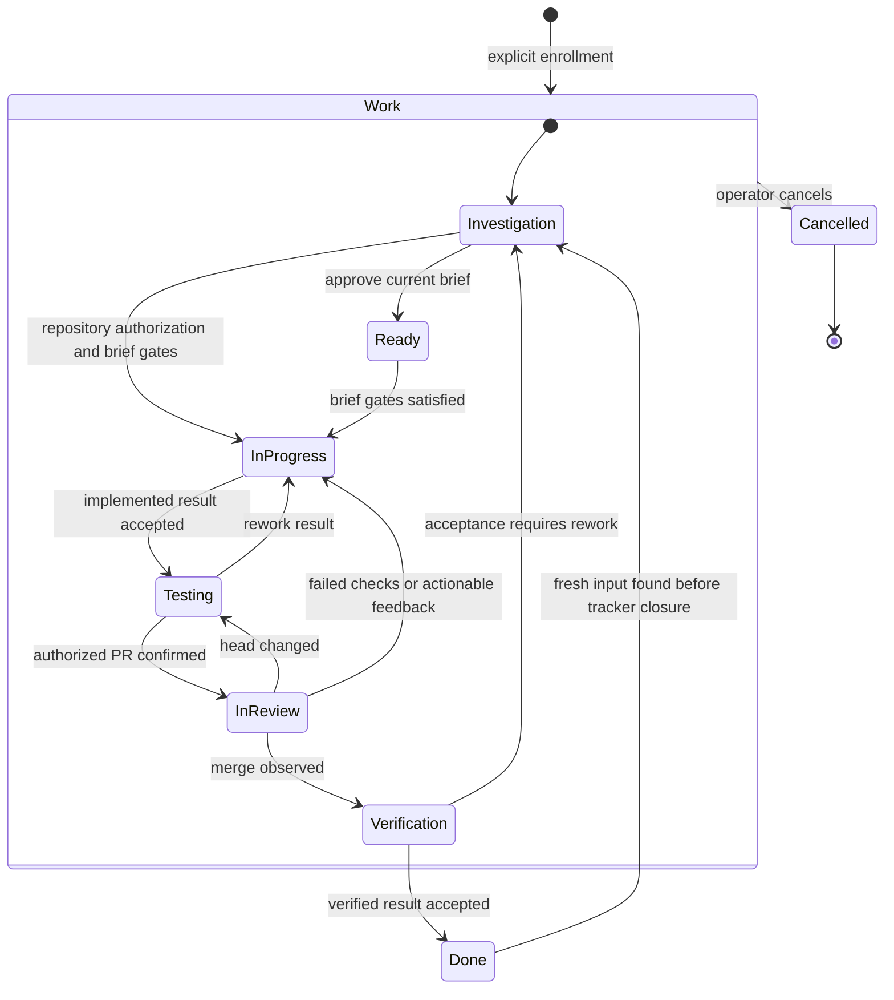
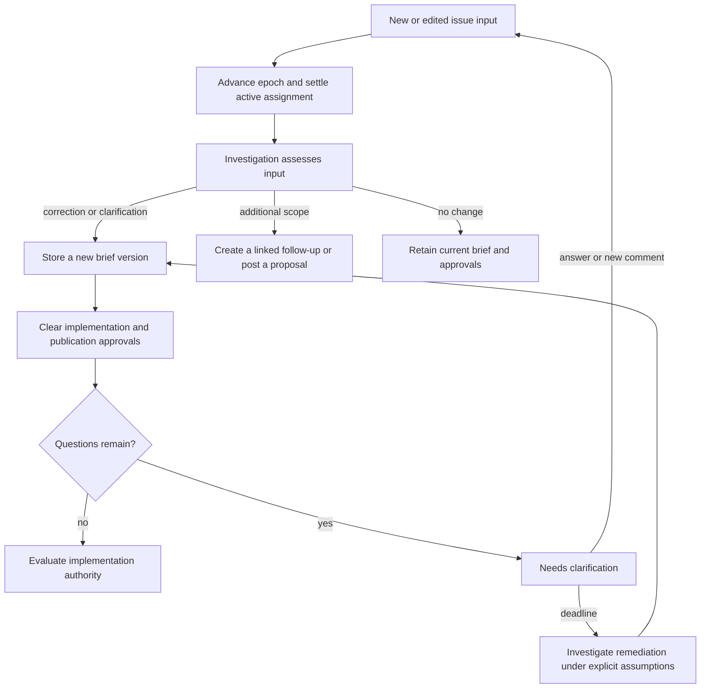
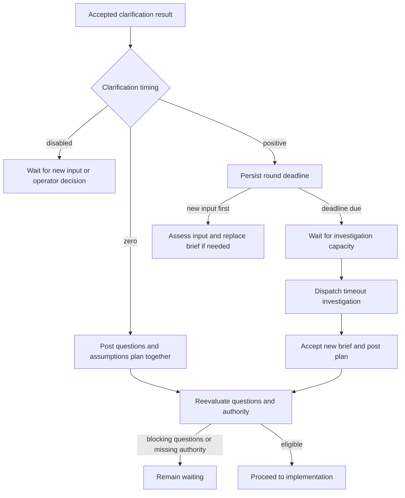
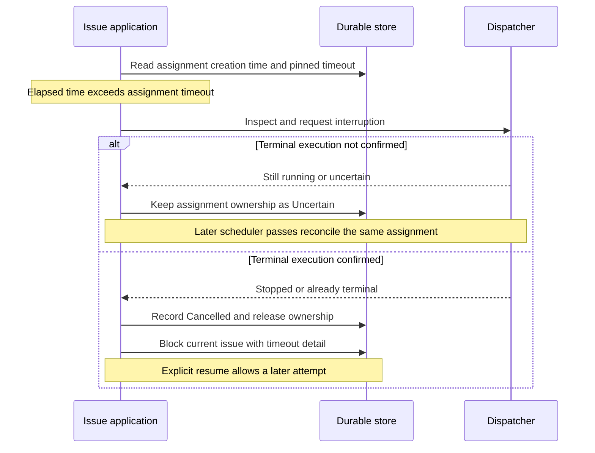
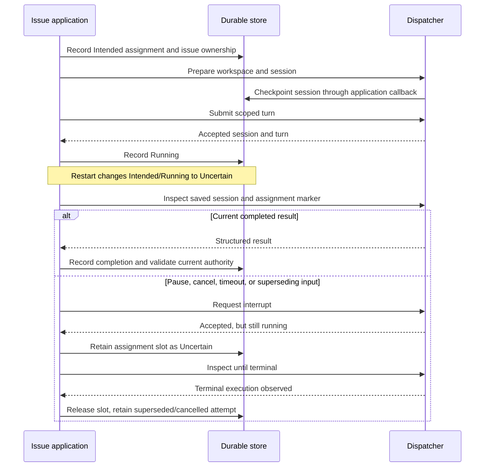
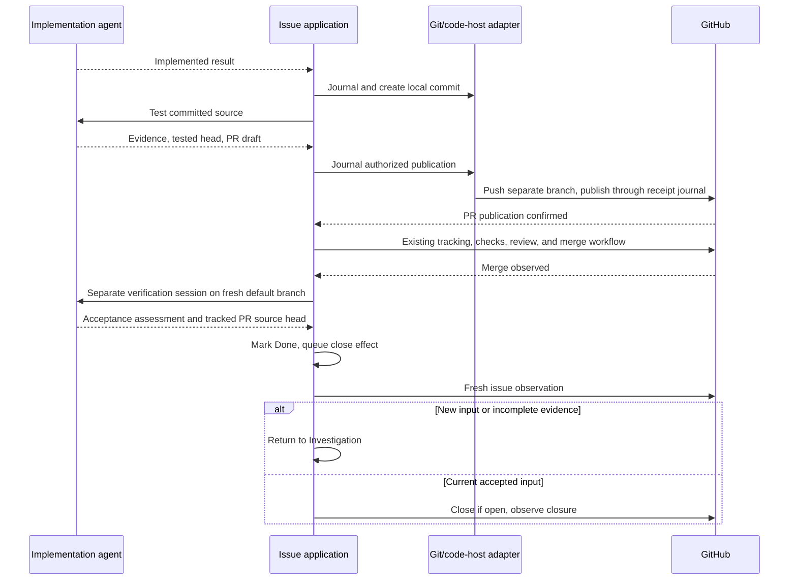

# Issue state machines and flows

Octo keeps issue progress, agent execution, and external effects separate. An agent can finish while its result still needs validation; an issue can be Done while tracker closure remains pending. Message receipt changes neither state machine. This guide describes the implemented transitions; [issue setup and commands](issues.md) cover operation.

## Issue progress and waiting

The persisted stage is `IssueStage`; `Waiting` is an independent condition. For example, Testing with Awaiting approval means tests were reported but publication needs approval. Testing with Blocked and “Publishing tested work through the code host” can mean the publisher effect is still pending, rather than a failed test. Inspect the detail and pending effects together.



Investigation results remain in Investigation, with Needs clarification or Awaiting approval. Ready is set by explicit approval, or by the immediate/timeout assumptions path when its gates permit progression; it is not a mandatory stop for repository-authorized work. Implementation requires a brief, no blocking questions, either no unanswered questions or an authorized assumptions plan, and either repository authorization or approval of that exact brief version.

| Waiting condition | Meaning and release |
| --- | --- |
| None | The next stage action may run when its other gates allow it. |
| Needs clarification | Investigation has questions. A new answer/input is assessed, or the configured deadline starts a timeout investigation. |
| Awaiting approval | An operator decision or applicable repository authorization is required; the stage identifies which decision. |
| Blocked | Inspect the detail, assignment, and pending effects. An agent failure usually needs `issue resume`; a pending publisher can reconcile independently. |
| Paused | Explicit pause or observed external closure stops dispatch. New comments do not undo an explicit pause. |

`issue resume` clears a nonterminal waiting condition and schedules a fresh observation; it does not approve a brief or publication. Done and Cancelled are terminal for ordinary commands. A pending close effect can send Done back to Investigation when it observes new input. Otherwise completed issues are not polled, `resume` cannot reopen them, and repeated enrollment returns the existing record rather than creating a new lifecycle.

## Clarification and changing scope

Every newly observed issue-body change or new/edited comment advances the issue epoch and supersedes active work before classification. The existing assignment keeps its slot until cancellation is confirmed. The investigation dispatcher then assesses the pending input.



The clarification deadline is persisted per round. Research and alpha default to immediate planning, beta to one hour, production to four hours; unknown maturity disables the timer. Immediate timing posts the questions and plan together. A timeout produces one plan per round, with unanswered questions and assumptions retained. It does not itself authorize implementation, publication, or merging. Blocking questions continue to stop implementation; unanswered nonblocking questions require `proceed_under_assumptions` and a timeout/immediate plan before implementation is eligible.

Answers from `issue answer` are recorded locally and queued for posting to the issue. GitHub replies enter through the next complete tracker observation. Classification and the plan are agent assessments. A revised brief clears both approvals; `no_change` preserves them, including clarification waiting and the existing round deadline. Follow-up creation needs repository authority or explicit approval of the current proposal assignment. This choice keeps added scope outside the current fix without silently discarding the comment.

## Deadlines, timeouts, and retries

The clocks below have different consequences. A clarification deadline asks an agent for a plan; an assignment timeout stops execution; a transport timeout leaves an outcome to reconcile. None grants new implementation, publication, or merge authority. Deadlines are evaluated when scheduled work runs, so elapsed time does not guarantee immediate dispatch: assignment capacity, provider cooldowns, interrupted execution and operator waiting conditions can delay progression.

| Clock | Configuration and start | On expiry | Recovery |
| --- | --- | --- | --- |
| Clarification round | `issues.clarification_timeout_ms`, disabled override, or maturity default; persisted when an accepted result enters Needs clarification | Queue an investigation assignment with purpose `timeout`, once a slot is available, unless that round already has a plan | Accept a new brief with explicit assumptions and remaining questions; reevaluate all authority gates. |
| Agent assignment | Stage profile `timeout_ms`, default 30 minutes; measured from persisted assignment creation, including preparation/acceptance delay | Request interruption when elapsed time exceeds the pinned timeout | Retain ownership until terminal execution is confirmed; then record Cancelled and block the current issue. Inspect evidence and explicitly resume to retry. |
| Coordinator operation | A supplied 30-second abort signal for dispatcher submit/inspect, tracker observation, and each effect pass; adapters also have local command bounds | An adapter that observes cancellation returns uncertainty or an error; this is not an enforced total operation deadline | Reconcile saved session/turn, marker, checkout, or publication receipt according to the operation. |
| Pending effect check | At least one minute between checks in this process | Recheck the existing intention, rather than creating a new intention | No overall abandonment deadline; pending/uncertain effects can remain unresolved. Restart resets this in-memory delay. |
| Issue observation | Adaptive one-to-fifteen-minute polling; In review and Verification retain one minute | Read current tracker evidence | Failed reads retain lifecycle evidence and block progression; the error path schedules another read without implicitly retrying an agent. |

The supplied operation signal is advisory: Codex RPC dispatch does not receive it directly and instead uses a ten-second timer per call. Code-host publication forwards the effect signal to its SDK requests. Those waits can outlast thirty seconds and delay the scheduler pass; a timer alone does not guarantee interruption or prompt uncertainty recording. Local Git commands have their own bounds.

Clarification accepts zero through seven days, or can be disabled. Assignment profiles accept one second through one day; testing uses the implementation profile and each dispatched assignment has its own clock. Changing policy does not rewrite the timeout already pinned to an assignment. There is no total issue-duration deadline, automatic approval expiry, or deadline that forces a dependency/check wait to merge. PR checks and dependencies use the existing PR workflow.



A timeout plan replaces the brief and clears its approvals. `proceed_under_assumptions` permits remaining nonblocking questions only when a timeout/immediate plan exists; implementation still needs `auto_implement` or approval of the resulting brief version. A timer never bypasses production merge policy. Immediate mode marks the initial question-bearing brief as the plan; it does not dispatch an additional timeout investigation. An accepted timeout plan prevents repeated timeout planning for that round, even when its questions remain unanswered.



Timeout handling precedes ordinary result consumption in the assignment poll. A result first observed after the deadline can therefore be discarded as a timed-out attempt even if the dispatcher reports terminal completion. A concurrent epoch change, pause or cancellation preserves that newer decision rather than replacing it with the timeout waiting state. An accepted interrupt request remains distinct from confirmed terminal execution.

## Separate authority gates

| Decision | Required authority/evidence | What it does not establish |
| --- | --- | --- |
| Investigate | Explicit enrollment and configured profile | Permission to edit or publish |
| Implement | Current brief gates plus `auto_implement` or exact-version approval | Publication or merge approval |
| Publish | Test evidence plus `auto_publish` or exact-version publication approval | Successful creation, merge readiness, or issue completion |
| Create follow-up | `auto_follow_ups` or approval of the current proposal assignment | Implementation authority for the new issue |
| Merge through Octo | Existing PR merge gates plus all linked issues in In review, without waiting, pending input, or blocking questions | Acceptance verification or tracker closure |
| Mark Done | Verification-role result in Verification, nonempty evidence, matching tracked PR source head | That GitHub has closed the issue |
| Close tracker issue | Done, a fresh complete issue observation without new input, and confirmed tracker closure | That an arbitrary closed issue passed verification |

Repository policy changes clear recorded issue approvals and advance the epoch. Current authority is rechecked after awaited operations and immediately before effect dispatch. Already-submitted external operations cannot be rolled back by a later pause or cancel; their confirmations remain evidence without advancing superseded work. The issue merge gate applies to Octo-owned merging, not to direct GitHub merges by another actor. Production's existing PR merge policy remains independent of the clarification timeout.

## Agent assignment and recovery

Issue assignments use dispatcher/session identity, not the Pi job worker's PID lifecycle. Investigation and verification get separate sessions; implementation can resume its earlier session for testing and remediation. Each assignment pins its issue epoch, brief version, workspace, harness, model, instructions, and timeout.



The session checkpoint precedes turn submission. Restart or lost acceptance never triggers blind resubmission. Codex inspection reads at most twenty recent turns with their items, looking for the recorded turn or assignment marker. Missing session identity, absent turns, unavailable history, and unconfirmed interruption remain uncertain; there is no force-release command in this increment. Resolve the underlying transport/history problem and inspect retained evidence before retrying work. A successful interrupt RPC alone does not release the slot.

Completed agent output is validated independently of transport success. A parsed result rejected by lifecycle validation records a failed attempt and blocks the issue; explicit resume permits another attempt. Missing or unparseable dispatcher output instead leaves assignment ownership uncertain and requires reconciliation before replacement; resume alone cannot release it. Concurrent operator decisions are re-read before applying results, so a late completion cannot undo pause/cancel or restore an older brief approval.

## Commit, publication, verification, and closure

Implementation agents write source in an isolated checkout. The coordinator commits locally because linked-worktree metadata lies outside the agent's writable root. Testing runs the project checks and returns evidence; authorized publication can use a caller-written draft and tested commit, or link a reported existing PR under the same publication gate. Coordinator-created PRs require a clean checkout with the exact tested commit and a confirmed publisher receipt. An existing `prUrl` enrolls tracking; it is not evidence that Octo created that PR. Remediation updates the linked open PR on the same verified repository, base and head branch, using a non-force push of the tested head. It preserves the PR description and reconciles the remote head before advancing, rather than opening another publication. A changed remote head requires observation and retesting.



Verification fetches a fresh default-branch checkout, which can include commits after the merge. The accepted verification result must report the tracked PR source head; the engine does not pin the checkout to the squash/merge commit or mechanically prove each criterion. Review the retained assessment/evidence accordingly. Failed verification returns to investigation for correction or a proposed follow-up.

PR descriptions link the issue without closing keywords, so merging does not prematurely close it. Done is acceptance status. The separate close effect observes the issue, checks for fresh input, closes an open issue, then observes closure. An already-closed tracker issue is confirmed without another close request. External closure before verification pauses dispatch and does not imply Done.

## Effects, inspection, and review boundaries

Issue stages and assignment states are enums. Coordinator effects have their own persisted intention/status and append-only events. Their reconciliation differs by operation:

| Effect | Confirmation and recovery |
| --- | --- |
| Question, answer, or plan post | Reconcile a stable marker; an uncertain write is not recreated merely because no match is visible. Old brief posts are superseded. |
| Follow-up creation | Reconcile a stable marker across a complete bounded issue inventory; missing/incomplete evidence does not authorize duplicate creation. |
| Local commit | Inspect the isolated checkout; commit remaining changes or retain its existing clean head. Filtered paths require a repository-specific adapter. |
| PR publication | Reuse the standalone publisher's frozen request and receipt; reconcile uncertain creation rather than creating another PR. |
| Issue closure | Observe, close only if open, then observe confirmation. This idempotent state operation can be retried. |

Pending effect checks are spaced by a minute in memory; restart can cause an immediate reconciliation read. Clarification deadlines and effect intentions survive restart. Issue observation backs off from one minute to fifteen minutes when unchanged, keeping In review and Verification at one minute. Shared provider cooldowns and request spacing still apply. Incomplete collections block progression and preserve the last usable lifecycle evidence.

`issue show --full` returns the latest ten brief versions, ten assignment attempts, twenty pending effects, and fifty lifecycle events. `--before` pages events; it does not page briefs or assignments. The dashboard holds up to fifty current issue summaries, and `issue list --offset` pages the full collection. A `completed` effect record can mean a now-inapplicable intent was retired; use its kind, URL, and lifecycle events before treating it as proof of a remote mutation.

Review the [decision core](../src/issues/decisions.ts), [application orchestration](../src/issues/service.ts), and [adapter contracts](../src/issues/ports.ts) together. The GitHub adapter bounds issue/comment collections at 1,000 records and rejects unsupported/incomplete reconciliation. The Git adapter uses trusted linked metadata, disables executable hook/filter paths, and fences writes with current authority. Controlled race and hostile-hook tests protect these boundaries; the dated [provider trial](live-acceptance.md#issue-lifecycle-provider-trial--2026-11-16) records what was exercised live, including the controller-owned fixture merges.

## Issue event subscriptions

Notification subscriptions are independent of issue execution. `octo-manager issue subscriptions ISSUE_ID` reports the implicit owner and other subscribers, each effective event selection, and its `legacy` or `selected` mode. Subscription operations require an existing enrolled issue and registered agent; they do not load dispatch profiles, change approval, resume workers, or cancel enrollment.

```sh
# Observe content changes without closure or polling-status notifications.
octo-manager issue subscribe ISSUE_ID --agent-id AGENT_ID --events title,description,comment
# Mute this subscriber while preserving enrollment and history.
octo-manager issue subscribe ISSUE_ID --agent-id AGENT_ID --events none
# Reset this subscriber to the legacy delivery default.
octo-manager issue subscribe ISSUE_ID --agent-id AGENT_ID
```

The event names are `title`, `description`, `comment`, `closed`, `reopened`, `coordinator`, `refresh_failure`, and `refresh_recovery`. The legacy default includes only coordinator progress and refresh failure/recovery notices. Existing owners retain that default until explicitly changed. An omitted RPC filter resets it; a present filter with an empty event array mutes delivery. New observers use the same default when they omit a selection. A comment event identifies a newly observed comment ID/revision, including an edit to an existing comment. Repeated observations of the same comment revision do not notify again.

The first complete provider observation establishes a baseline without replaying historical comments. Complete later snapshots produce observed changes; an incomplete or failed read retains the prior baseline. Polling cannot capture edits that occur and revert entirely between observations. Explicit source-event subscribers can continue read-only observation of terminal issues after retained assignment reconciliation has cleared the assignment identity; closure, reopening, or comments cannot restore execution authority or undo cancellation. Without selected source events, terminal retirement behavior remains unchanged.

Event filtering applies before subscriber inbox creation. Changing preferences also makes excluded pending notices inapplicable, so the normal digest reconciler can withdraw and replace queued mixed digests. Already received notices and immutable digest revisions remain in history; a subscription change cannot retract content already received by a session. Selected content events remain readable when unrelated coordinator status changes. Automatic notifications contain only fixed event identity and kind; `octo-manager messages show RECEIPT --full` inspects bounded untrusted evidence without recording receipt; `octo-manager read RECEIPT` retrieves that evidence and records delivery. The evidence is frozen at observation time, with truncation indicators and full observed-string digests when an excerpt is limited. Current issue state and the original event evidence are separate fields.

The GitHub adapter retains its completeness guard: a comment over 16,000 code units or an incomplete paged comment read marks the whole observation incomplete. This can postpone title, description, and closure events as well as comments; previous complete evidence remains authoritative until a complete observation succeeds. Refresh failure and recovery are independent historical events, so an explicitly selected transient failure remains readable after recovery.
