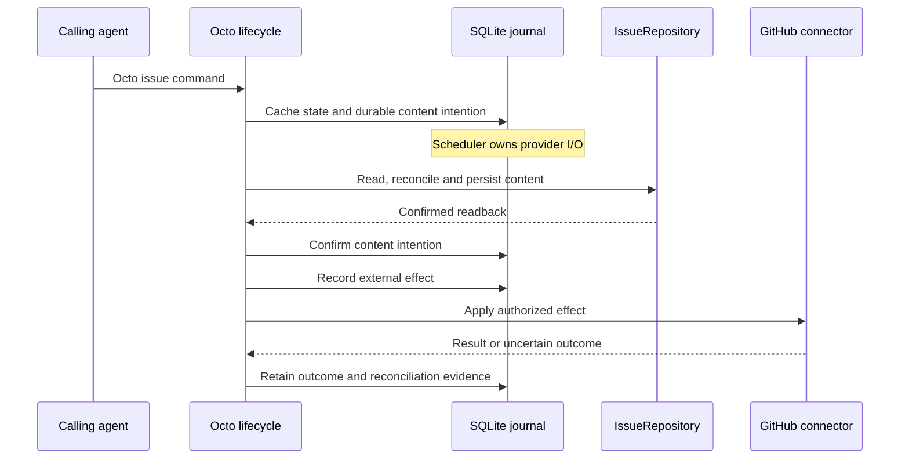
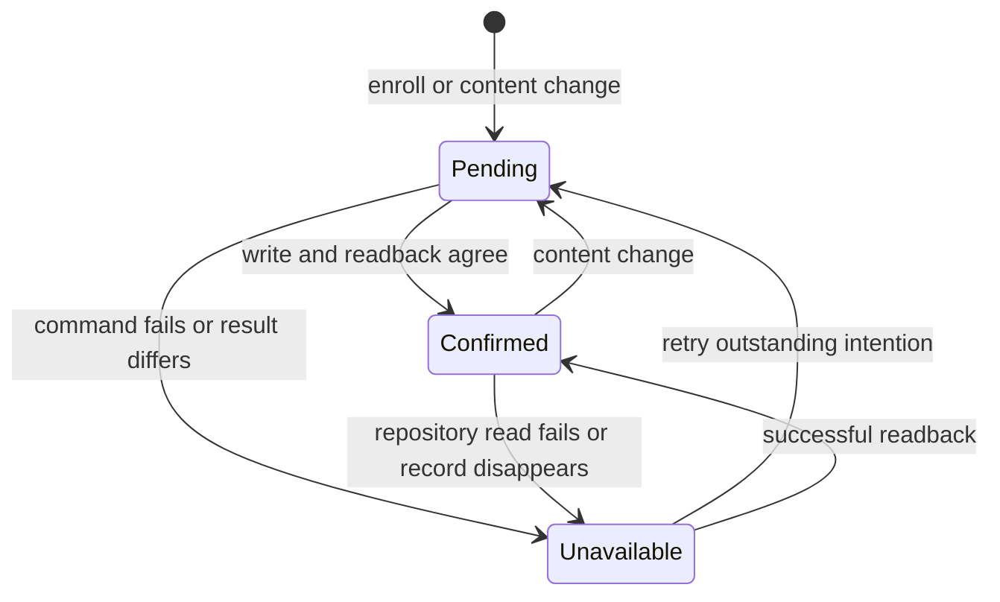

# Issue storage

Octo owns issue identities, lifecycle stages, waiting conditions, approvals and dispatch. `IssueRepository` persists content; Beads is one backing-store adapter, independent of the GitHub issue connector. CLI commands, agent messages and PR descriptions use Octo IDs and GitHub links. Beads IDs are private storage keys.

## Ownership and configuration

| Data | Authority |
| --- | --- |
| Title, description, open/closed state, comments and current brief | Configured issue repository |
| Stages, waiting conditions, approvals, deadlines, assignments and sessions | Octo SQLite execution journal |
| Historical briefs, events, storage intentions and GitHub effects | Octo SQLite evidence and outbox |
| PR observations, merge chains, publication and notifications | Existing Octo PR services |

The SQLite issue row is a cached view plus execution state. With external storage configured, the scheduler confirms content against that repository before dispatch or effects. Cached content is never used to recreate a missing previously confirmed record. An unavailable repository blocks work while retaining the prior waiting condition and clarification deadline. Read-only CLI/dashboard inspection shows the cached view; `issue show --full` includes pending or failed `persist_content` effects and retained events.

Configure storage independently of issue profiles in repository `octo-manager.toml`:

```toml
[issues.storage]
backend = "beads"
```

The repository still needs the stage profiles described in [issue configuration](issues.md#repository-configuration). Omitting storage selects existing SQLite persistence. Removing or changing storage configuration for an already migrated issue fails explicitly rather than falling back to SQLite. Storage selection participates in the repository policy hash and therefore invalidates prior policy approvals.

The coordinator's `OCTO_MANAGER_BEADS_WORKSPACE` selects the existing shared service workspace; the default is `~/.local/state/beads-service/workspace`. `OCTO_MANAGER_BEADS_BINARY` optionally selects the pinned native executable, otherwise `bd` is resolved on PATH. These are host settings, not repository paths. Installation and database initialization are explicit prerequisites; Octo does not start a second Beads server or initialize storage implicitly.

The adapter executes bounded argument-vector commands without a shell, strips ambient Beads/Dolt routing overrides, and serializes mutations through Octo's scheduler. The native process timeout is 15 seconds within the scheduler's 30-second storage operation deadline. It uses native import, filtered reads and comments with validated JSON. Beads retains native commit history. Native type, priority, labels and dependency fields are preserved; the current Octo issue model does not expose edits to those fields. Domain comments retain their original identities, revisions, attribution and URLs in adapter metadata alongside native comments. Other harnesses can edit title/description/status and add native comments; changing private `octo.*` metadata requires preserving its schema.

## Persistence and recovery



The SQLite intention commits before the repository write. Writes carry the expected observation and reject known intervening target changes. Native import and GitHub GET/PATCH do not provide a shared atomic compare-and-swap: an external writer in the final check-to-write interval follows provider ordering; these checks do not establish race-free concurrent writers. A crash after the write is reconciled by readback; a newer command admitted while the write is in flight retains its own pending intention. Dispatch, merge eligibility and effects remain gated until content is confirmed. Provider errors are distinct from absent records. Only a record without a confirmed baseline may be created from its initial pending intention.



Storage health is orthogonal to the lifecycle waiting condition. A failure does not turn clarification, approval or explicit pause into a different workflow. Recovery retains that condition. Already-running assignments are interrupted through the existing dispatcher reconciliation; acceptance of interruption does not release their execution slot.

## Input and GitHub synchronization

Direct storage edits become ordinary issue input. Content changes advance the Octo epoch, retained comments enter assessment, and changed briefs invalidate approvals. Explicit pause remains in force. Native closure pauses dispatch but does not establish Octo verification.

GitHub title/body/state observations compare against the last GitHub snapshot, so an unchanged remote issue cannot overwrite a direct storage edit. Independent fields merge. Competing changes use source modification timestamps, with the stored value winning ties; both values and the decision are retained in conflict events. Beads timestamps can have second precision, so ties are an intentional part of this policy. Comments preserve source identities/revisions and native additions have separate Octo input identities.

Stored title/body/state edits queue `sync_content`; native comments queue `sync_comment`. These effects use the existing SQLite journal and scheduled GitHub adapter. Synchronization authorization is separate from execution authorization: a paused issue can synchronize its content without dispatching, publishing or merging. Reflected Octo posts are recognized by their existing operation markers and excluded from new-input assessment. Unknown comment-post outcomes reconcile their marker rather than blindly recreating a post. Failed field updates retry the current confirmed content. Nothing discovers or imports additional GitHub issues automatically.

## Internal-record migration

Migration reads Octo's existing `managed_issues` records for the selected checkout. It does not enumerate or import GitHub issues, convert PR submissions into issues, or move PR tracking/history. An older database with no issue table reports zero records without creating an issue schema or contacting Beads.

```sh
octo-manager issue storage migrate --cwd /path/to/repo --dry-run
# Stop the coordinator before applying a nonempty migration.
octo-manager issue storage migrate --cwd /path/to/repo
```

Dry-run uses query-only SQL. Bun 1.4.4 may need SQLite WAL sidecars, so this can perform SQLite file housekeeping but cannot mutate application tables. Applying a nonempty migration requires the coordinator ownership lock and rejects live, intended or uncertain assignments. It creates a consistent SQLite backup and private manifest under `<state>/migration-backups/issue-storage-<migration-key>/`, pauses each previously unmigrated issue once, persists and verifies its content, then records completion in the SQLite migration journal. The manifest atomically mirrors that journal. Enrollment also seeds the last tracker values from the original issue snapshot, without inventing a provider revision; first post-migration observations therefore preserve newer storage edits. Missing baselines on resumed or completed migrations are recovered from the verified original checkpoint, never from current edited content. Existing baselines remain unchanged. Never-observed enrollments retain normal first-observation initialization. The backup key includes the target and original source snapshot, so a retry before enrollment reuses the same checkpoint. Original issue UUIDs, GitHub references, execution bindings, deadlines and historical evidence remain intact. Resume each issue explicitly after inspection.

The command is idempotent by Octo issue ID and target repository. A completed rerun reports `already_migrated`, `migrated: 0`, and `alreadyMigrated`; it reads the target to verify presence but does not rewrite content, re-pause issues, change epochs, append migration events, or create backups. Legitimate edits and resumes after migration remain intact. New issues are handled incrementally. An interrupted migration resumes its durable `started` receipt and original verified backup rather than repeating its pause or an already confirmed provider write. A confirmed binding completes a receipt even if the process exited before marking completion. Missing or damaged checkpoints prevent unfinished migration from resuming. Conflicting pre-existing target content is an error. Keep the backup and manifest. Do not restore a pre-migration SQLite file over a live coordinator or delete repository records as an automatic rollback: compare the confirmed repository content and execution journal first. Beads history/checkpoint recovery remains separate from the SQLite backup.

## Verification

`bun test test/issue-storage.test.ts test/issues.test.ts test/issue-tracker.test.ts` exercises internal migration, empty legacy databases, identity preservation, durable intentions, storage failures, concurrent admission, direct edits, conflict evidence, paused synchronization and retained lifecycle behavior with controlled provider boundaries.

`OCTO_BEADS_ACCEPTANCE=1 bun test test/beads-storage.test.ts` uses the installed native Beads executable in a disposable initialized database. It verifies actual persistence through `synchronizeIssue`, fresh adapter reads, repeated imports, comments, native edits and preservation of unowned fields. It does not contact GitHub or modify the shared workspace. It is opt-in because it requires the native Beads runtime. A successful local native test does not establish hosted GitHub synchronization or a live migration result.
