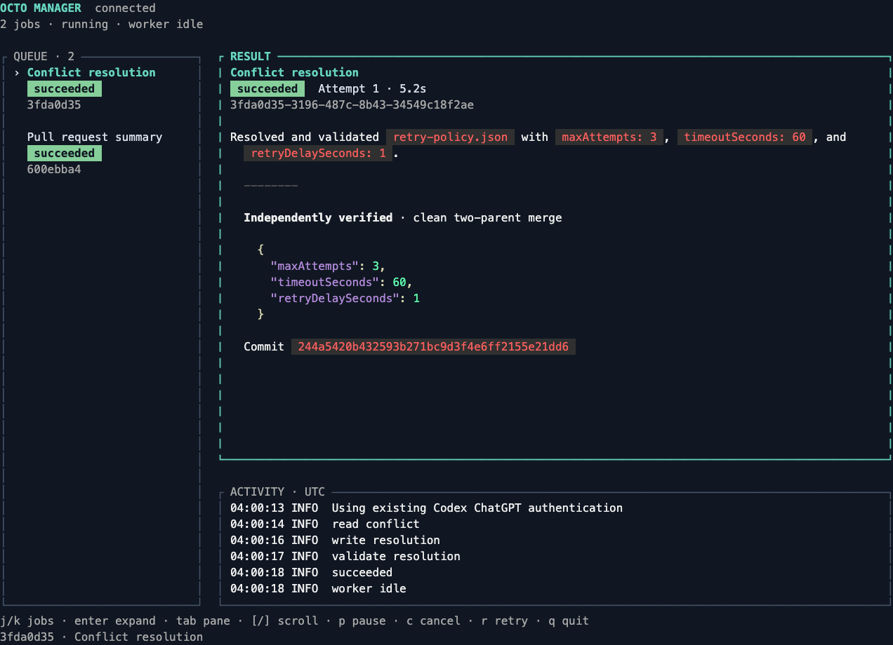
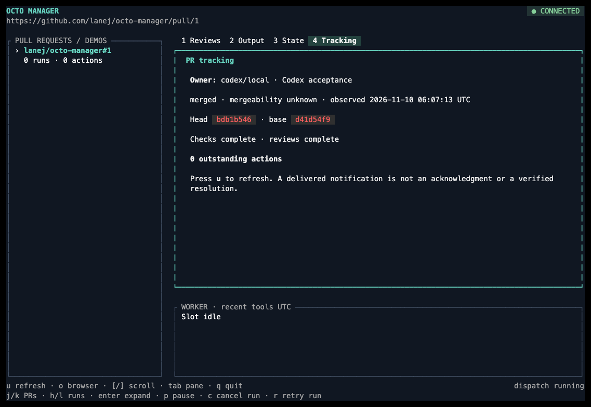
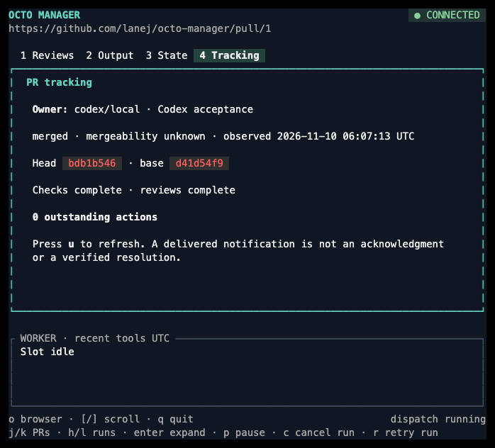
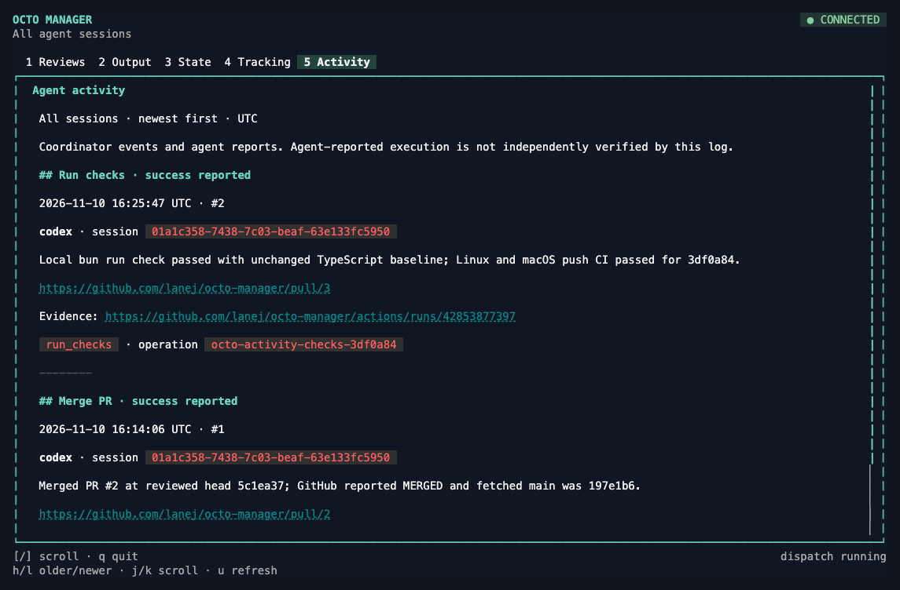
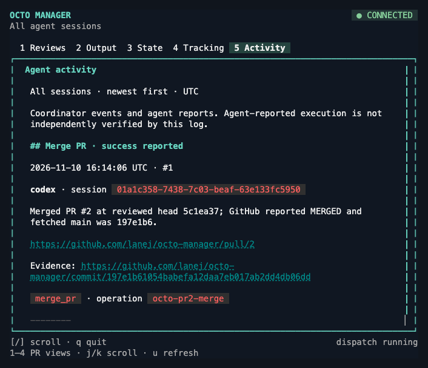
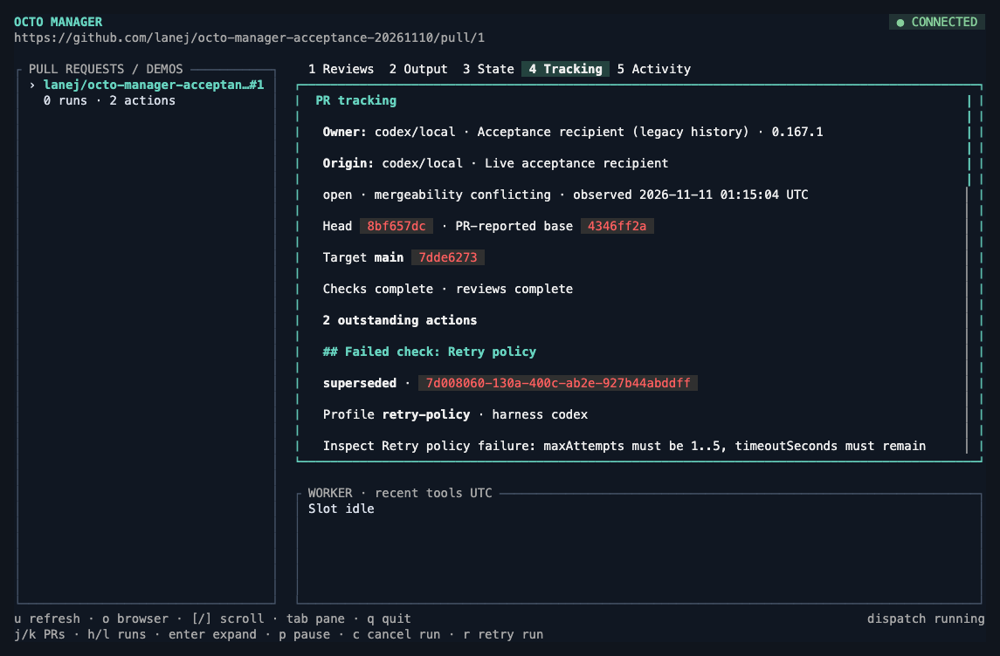
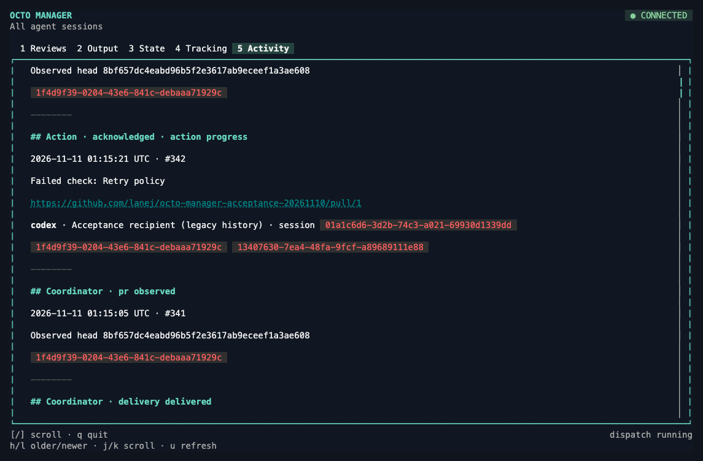

# Live steel-thread acceptance

On 2026-11-09, Octo Manager ran the native Charmed review workspace against its Bun/Pi coordinator through generated Connect clients over a Unix socket. Existing file-backed Codex ChatGPT and GitHub CLI authentication were reused; no additional sign-in or credential file was created.



The default pane reads real reviews, inline comments, and discussion from public [Bubble Tea PR 1836](https://github.com/charmbracelet/bubbletea/pull/1836). It shows the author, message date, file context, direct message URL, and earlier-commit marker separately from worker output. The PR header shows the observed GitHub state and head. The selected run’s worker status, attempt, PID, exit observation, and recent tools remain visible below. The PR URL appears once in the application header.


The screenshots show actual ANSI output from continuously drained native Go PTYs at 132×40 and 80×32, replayed in xterm.js and photographed by headless Chromium. No sample snapshot or fabricated message was substituted. Terminal colors were enabled instead of inheriting the automation environment’s `NO_COLOR` setting. The captures use Charmed’s `f502811` revision from [log-level atoms PR 29](https://github.com/lanej/charmed/pull/29): native tabs, header/footer, connection indicator, scrollbar, log-level atoms, and state diagrams. The final capture reattached to the same persisted live results after UI refinements.

Worker summary `324ff734-eecb-4f2e-acaf-3b1f334f8104` and conflict demo `5f4a53f8-f8e4-440b-be30-430b3c5967cf` both succeeded on their first attempt, with their exits observed before the slot was released. The **2 Output** tab showed the live summary independently of the review feed. **3 State** highlighted the latest observed transition in the native diagram and showed the complete persisted transition history:


The worker tool log uses Charmed’s semantic INFO atom.

The conflict passed through `queued → running → conflicted → resolving → succeeded`. Its history contains actual Git conflict detection followed by Pi’s `read_conflict`, `write_resolution`, and `validate_resolution` tool calls. The coordinator independently verified this result:

```json
{"policy":{"maxAttempts":3,"timeoutSeconds":60,"retryDelaySeconds":1},"mergeCommit":"4d8508dc63fd246b17c1e038149b88947c0ba719","clean":true}
```

The state diagram describes a worker run, not GitHub’s PR lifecycle. Sequence order preserves transition history across retries and equal timestamps. The State tab loads complete selected-run history through paginated `ListEvents`; controlled tests exercise a transition beyond the latest 100 snapshot events and across a 200-record page boundary. They also switch runs while a response is pending and reselect the original run, checking that stale history cannot cross the selection boundary.

Review-message reads are public-only, bounded to the first 100 records per source and 4,000 characters per body, and explicitly mark partial or truncated content. Earlier-commit markers do not infer whether a thread is resolved. Refresh is explicit with `u`; failed refreshes retain prior messages with their original observation timestamp and a visible error. GitHub reads are independent observations, not an atomic snapshot or a claim that review findings are still unresolved.

An earlier live pass grouped two summaries under one PR and exercised `h/l` run history. Another pass quit during active resolution and confirmed the coordinator and jobs continued, then reattached to their persisted results. The current workspace also switched Reviews/Output/State, resized, and detached successfully while its coordinator stayed alive. Browser-key dispatch was previously checked in an actual PTY with a controlled opener receiving the exact PR URL; the OS/browser handoff itself was not exercised.

`bun run check` passes scheduler/auth/API checks, generated Go-to-Bun unary and streaming calls (including review fields), strict Go lint, race tests, and reachable-vulnerability analysis. Independent review found no actionable issues in the Charmed component integration. Remote GitHub writes were not exercised and are unsupported. The merge hash belongs to the disposable local acceptance repository, not a published commit.

To repeat, follow the README build instructions, start `serve --state DIR`, and run `demo --state DIR --url https://github.com/charmbracelet/bubbletea/pull/1836 --request-id UNIQUE_ID --json`. Attach `dashboard --state DIR`; use `1/2/3`, `u`, `j/k`, and `h/l` to inspect reviews, worker output, state, and runs. Usable credentials and network access are required; this records the observed run rather than future provider availability.

## Tracking and Codex delivery

On 2026-11-10, the tracking coordinator read the merged Octo Manager PR #1, including its actual head/base revisions and successful check runs. The native dashboard displayed that independently tracked PR with no worker job. Wide (132×40) and narrow (80×32) captures replay continuously drained native PTY output in xterm.js; the images below show actual GitHub observations, not sample PR state.





The existing Codex daemon identified itself as 0.167.0. Its local control socket requires WebSocket framing; the CLI proxy forwards raw bytes and does not translate newline JSON. A disposable thread `01a1c40a-c72d-7b30-8114-1a4d63c20206` received delivery `870a99ab-bb50-45de-8d89-b46977d0f621` in turn `01a1c40b-b423-7393-bff3-ce9d45b76bce`. Thread history confirmed the stable delivery marker and the agent's triage response. No session model or permission overrides were sent.

That delivery used an explicitly synthetic conflict observation in an isolated database to exercise notification; it does not establish that merged PR #1 had a conflict. Its placeholders were `acceptance-head` and `acceptance-base`. The receiving agent attempted the exact acknowledgment command but its sandbox received `ECONNREFUSED` for the coordinator socket. Therefore live message delivery and processing were confirmed; recorded live acknowledgment was not. The action remained open until the next real GitHub observation superseded it because the PR was merged. Controlled CLI/Connect tests separately verify acknowledgment and work reporting.

The recipient's failed callback illustrates the retained boundary: a delivered message does not establish action acceptance, and Octo does not relax the session's permissions to manufacture success. Agents with denied socket access need their existing host approval path. No private provider-backed acceptance was performed; private metadata separation is covered with controlled GitHub responses.

## Named agent activity

On 2026-11-10, the activity reporting CLI recorded the actual Octo PR #2 merge as `merge_pr` / `succeeded`, correlated by `octo-pr2-merge`. Its evidence links to merge commit `197e1b61054babefa12daa7eb017ab2dd4db06dd`, independently checked against GitHub and fetched `main` during the merge. This report was written after the merge; its recorded time describes ingestion, not execution time. Replaying the same request returned sequence 1 without duplicating it.

The trial used an isolated coordinator database at `/private/tmp/octo-activity-runtime/live-state/jobs.sqlite`, not the default user database. The coordinator was stopped and reopened repeatedly during capture, and the same report remained visible without a worker job or tracked PR. External session activity still requires explicit CLI/RPC reporting; no automatic harness hook was installed.

Actual native Go PTY output at 132×40 and 80×32 was replayed in xterm.js with its resize events, then photographed with headless Chrome. The captures were inspected at both sizes, including the bottom edge, selected Activity tab, wrapped evidence URL, and footer. No fixture snapshot was substituted for the API response.





## Acceptance evidence fixes (2026-11-10)

The disposable public [acceptance repository](https://github.com/lanej/octo-manager-acceptance-20261110) and [PR #1](https://github.com/lanej/octo-manager-acceptance-20261110/pull/1) exercised actual failed GitHub checks, competing target edits, Codex app-server handoffs, and recipient-side acknowledgment. The version 2 acceptance database migrated to version 3 while preserving its identity, reports, event cursor, and existing unknown historical contexts.

A fresh failure at head `8bf657d` and target edit `7dde627` produced new failed-check and conflict actions. GitHub’s PR payload still reported base `4346ff2`; the fixed reader separately stored current target `main` at `7dde627`, and the conflict action/notification used that target revision. A deliberately nonexistent Codex thread produced a real persisted diagnostic: `Codex thread/resume rejected (RPC -32600, runtime 0.167.1): no rollout found for thread id 00000000-0000-4000-8000-000000000000`. The installed CLI remained 0.167.0; the daemon’s observed version was retained independently.

After ownership returned to the disposable recipient, both new actions reached `acknowledged` through the actual CLI callback and normal host approval flow. SQLite and event replay retained each state, acting session, harness, label, and PR URL. Earlier version 2 progress events remained explicitly unknown. Native PTY captures replayed in headless Chrome show the current target and the real acknowledgment entry; controlled tests alone were not used as evidence of the external handoff.





The independent review caught a moving-mergeability case during the bounded GitHub read. The reader now rejects changed mergeability as well as changed revisions/lifecycle, retaining preceding evidence. Regression coverage holds the target/head/ref/lifecycle stable while changing the final mergeability response. These checks do not establish an atomic GitHub snapshot or exclusive ownership of Codex scheduling.

The recipient then separately received authorization to repair the fixture, marked both actions working, and pushed [merge commit `a21d606`](https://github.com/lanej/octo-manager-acceptance-20261110/commit/a21d60669348fd483f6e7fee3744856e4a17a58e) with `maxAttempts=5` and `timeoutSeconds=60`. Both real hosted checks succeeded. A later Octo refresh independently observed the repaired head, complete successful checks, and mergeability, leaving zero unfinished blockers. The preceding actions were retained as superseded; all four acknowledgment/working event contexts remained byte-for-byte unchanged. SQLite integrity and foreign-key checks passed. PR #1 remained open and unmerged.
