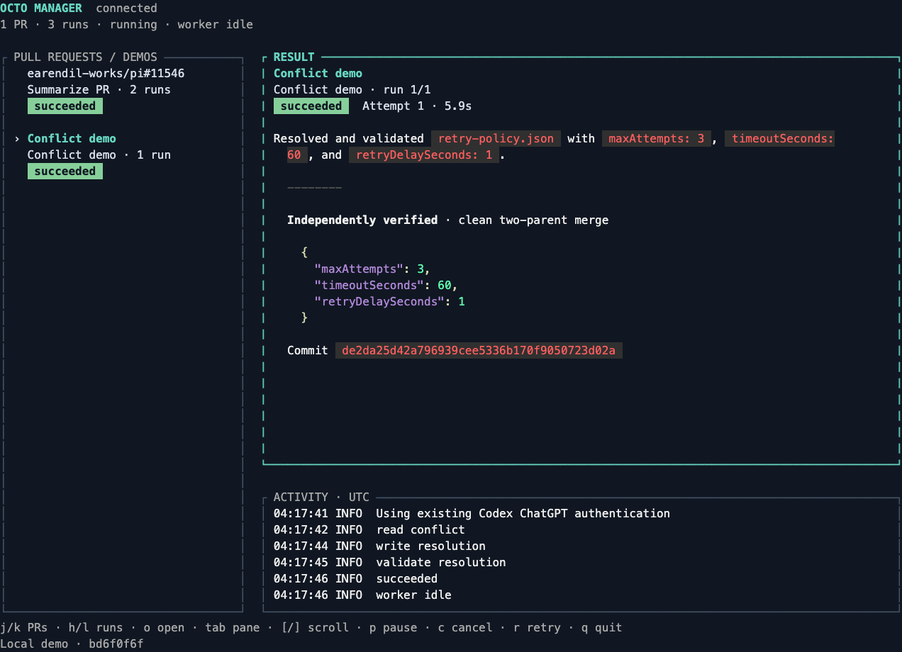

# Live steel-thread acceptance

On 2026-11-08, Octo Manager ran the native Go/Charmed dashboard against the Bun/Pi coordinator over the generated Connect Unix-socket API. The workers reused the existing file-backed Codex ChatGPT session and GitHub CLI authentication. No additional sign-in or credential file was created.


The refreshed screenshots show actual persisted results from a 132-column, 40-row PTY, continuously drained to avoid backpressure. Captured ANSI output was replayed in xterm.js and photographed by headless Chromium; no sample snapshot was substituted. Terminal colors were enabled rather than inheriting the automation environment's `NO_COLOR` setting.

Two live summaries of [Pi PR 11546](https://github.com/earendil-works/pi/pull/11546), runs `7eb563a3-8435-4d31-81c2-5e0502d5f447` and `e926ae0a-fcb8-4338-9780-ee05e932aebd`, both succeeded on their first attempt. The dashboard shows one PR entry with two runs, selects the latest run on attachment, and displays the full URL. `h` selected the first run, `l` returned to the second, and `j` moved to the distinct conflict demo. Run results and activity remained associated with their selected job handles.

Pressing `o` in the actual PTY dispatched exactly `https://github.com/earendil-works/pi/pull/11546` to a controlled `open` executable. This verifies key-to-launcher dispatch and URL selection without opening a visible browser. The OS/browser handoff itself was not exercised. Automated checks cover fixed macOS/Linux opener arguments, unsafe-target rejection, and visible opener failures. Resizing the actual PTY to 80 columns and 32 rows produced this layout:


The local conflict demo `bd6f0f6f-c64e-46a5-99ce-751182aad192` passed through `queued`, `running`, `conflicted`, `resolving`, and `succeeded`. Its events contain real Git conflict markers and the model's `read_conflict`, `write_resolution`, and `validate_resolution` calls. The coordinator independently checked the combined policy, clean worktree, and two-parent merge before reporting success.

```json
{"policy":{"maxAttempts":3,"timeoutSeconds":60,"retryDelaySeconds":1},"mergeCommit":"de2da25d42a796939cee5336b170f9050723d02a","clean":true}
```



All three worker exits were observed, and FIFO dispatch continued only after the previous worker exited. The demo has no fabricated GitHub URL. Completed worker runs do not establish current GitHub review, CI, mergeability, or merge state. Remote GitHub writes were not exercised; this implementation supports public reads only.

An earlier acceptance pass on the same date verified detachment during active resolution: quitting the dashboard left conflict job `3fda0d35-3196-487c-8b43-34549c18f2ae` resolving, the coordinator alive, and both queued jobs able to complete. Reattachment displayed persisted results. The CLI dashboard wrapper also attached and exited successfully. The refreshed PR-centric dashboard likewise detached successfully while its independent coordinator stayed alive.

`bun run check` builds both applications and passes the Bun scheduler/API tests plus the strict Go profile, race tests, and reachable-vulnerability scan. Generated Go unary/streaming calls run against an actual Bun Unix-socket server in controlled tests. PR grouping, historical run selection, stream resynchronization, and retry-output isolation have regression coverage. Independent review found no remaining actionable issues in these changes.

To repeat, follow the README build instructions, start `serve --state DIR`, and submit a public PR URL with `submit summarize-pr --url URL --state DIR --request-id UNIQUE_ID --json`. Submit the same URL with another request ID for another run, then attach `dashboard --state DIR`. Inspect individual execution handles through `get` and `events`; use `demo` for the separate disposable conflict. Existing usable credentials and network access are required. The recorded merge hash belongs to the disposable local acceptance repository and is not a published commit.
