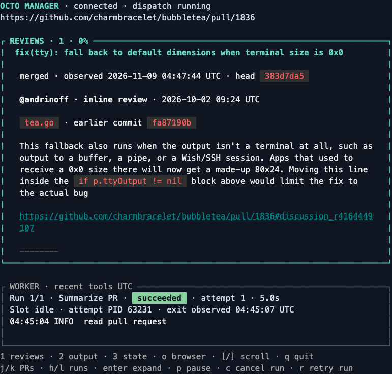
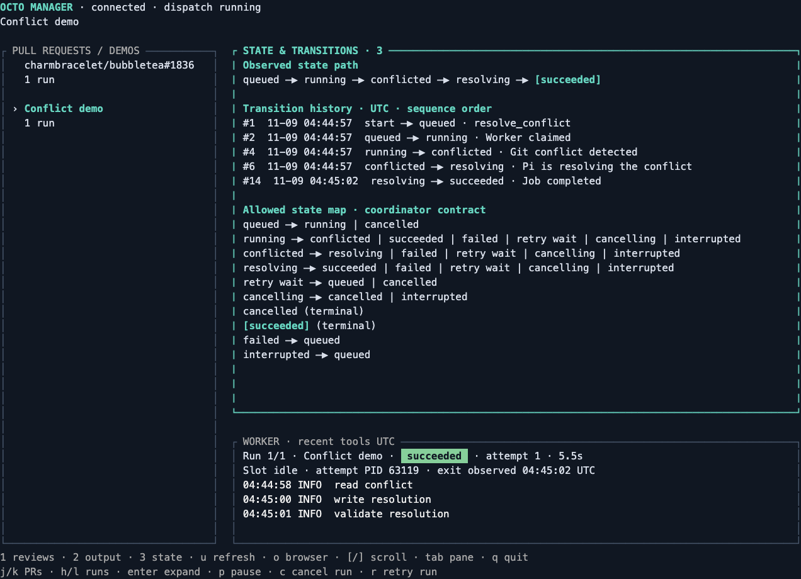

# Live steel-thread acceptance

On 2026-11-08, Octo Manager ran the native Charmed review workspace against its Bun/Pi coordinator through generated Connect clients over a Unix socket. Existing file-backed Codex ChatGPT and GitHub CLI authentication were reused; no additional sign-in or credential file was created.


The default pane reads real reviews, inline comments, and discussion from public [Bubble Tea PR 1836](https://github.com/charmbracelet/bubbletea/pull/1836). It shows the author, message date, file context, direct message URL, and earlier-commit marker separately from worker output. The PR header shows the observed GitHub state and head. The selected run’s worker status, attempt, PID, exit observation, and recent tools remain visible below. The PR URL appears once in the application header.



The screenshots show actual ANSI output from continuously drained native Go PTYs at 132×40 and 80×32, replayed in xterm.js and photographed by headless Chromium. No sample snapshot or fabricated message was substituted. Terminal colors were enabled instead of inheriting the automation environment’s `NO_COLOR` setting. The final capture reattached to the same persisted live results after UI refinements.

Worker summary `c1cf7b64-53e9-44c7-a647-aae209b47d06` and conflict demo `292b9a72-f999-4d3a-a024-0de89238abc8` both succeeded on their first attempt, with their exits observed before the slot was released. The **2 Output** tab showed the live summary independently of the review feed. **3 State** showed persisted transitions and the allowed state map from the coordinator’s domain graph:



The conflict passed through `queued → running → conflicted → resolving → succeeded`. Its history contains actual Git conflict detection followed by Pi’s `read_conflict`, `write_resolution`, and `validate_resolution` tool calls. The coordinator independently verified this result:

```json
{"policy":{"maxAttempts":3,"timeoutSeconds":60,"retryDelaySeconds":1},"mergeCommit":"2713869d8af65cfc73c18d764e56f5953a7d7a38","clean":true}
```

The state diagram describes a worker run, not GitHub’s PR lifecycle. Sequence order preserves transition history across retries and equal timestamps. The State tab loads complete selected-run history through paginated `ListEvents`; controlled tests exercise a transition beyond the latest 100 snapshot events and across a 200-record page boundary. They also switch runs while a response is pending and reselect the original run, checking that stale history cannot cross the selection boundary.

Review-message reads are public-only, bounded to the first 100 records per source and 4,000 characters per body, and explicitly mark partial or truncated content. Earlier-commit markers do not infer whether a thread is resolved. Refresh is explicit with `u`; failed refreshes retain prior messages with their original observation timestamp and a visible error. GitHub reads are independent observations, not an atomic snapshot or a claim that review findings are still unresolved.

An earlier live pass grouped two summaries under one PR and exercised `h/l` run history. Another pass quit during active resolution and confirmed the coordinator and jobs continued, then reattached to their persisted results. The current workspace also switched Reviews/Output/State, resized, and detached successfully while its coordinator stayed alive. Browser-key dispatch was previously checked in an actual PTY with a controlled opener receiving the exact PR URL; the OS/browser handoff itself was not exercised.

`bun run check` passes scheduler/auth/API checks, generated Go-to-Bun unary and streaming calls (including review fields), strict Go lint, race tests, and reachable-vulnerability analysis. Independent review’s stale-history finding is fixed and covered. Remote GitHub writes were not exercised and are unsupported. The merge hash belongs to the disposable local acceptance repository, not a published commit.

To repeat, follow the README build instructions, start `serve --state DIR`, and run `demo --state DIR --url https://github.com/charmbracelet/bubbletea/pull/1836 --request-id UNIQUE_ID --json`. Attach `dashboard --state DIR`; use `1/2/3`, `u`, `j/k`, and `h/l` to inspect reviews, worker output, state, and runs. Usable credentials and network access are required; this records the observed run rather than future provider availability.
